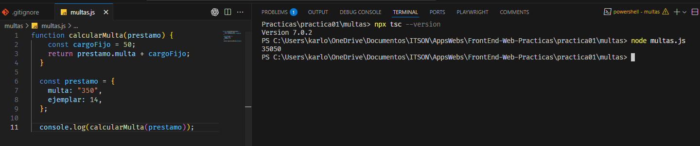
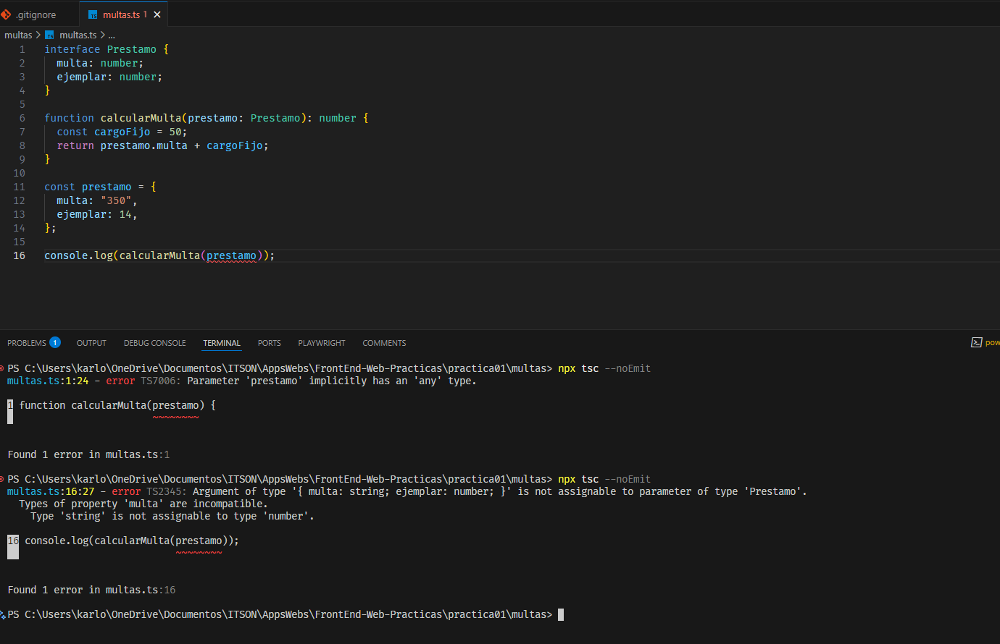
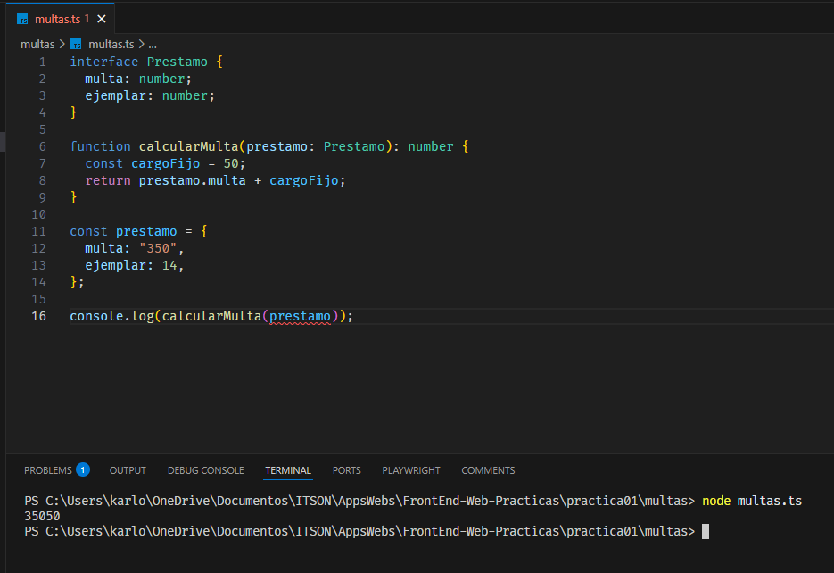
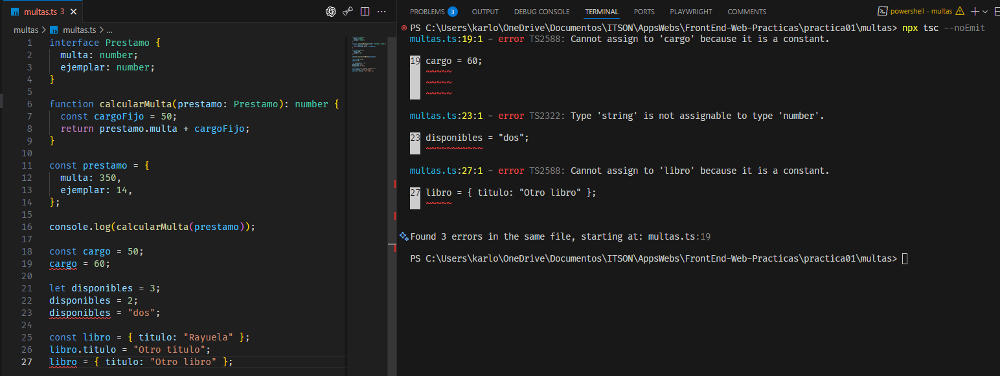
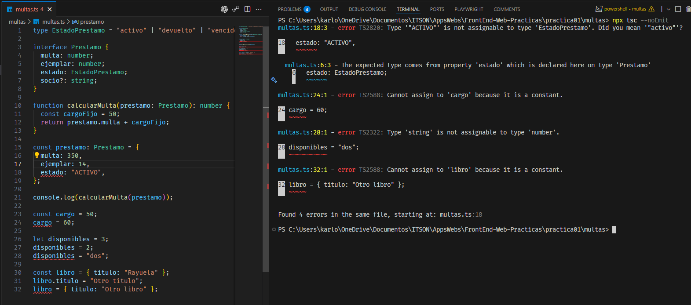
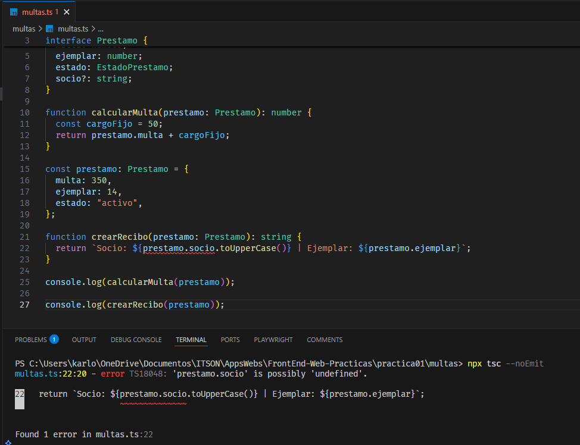
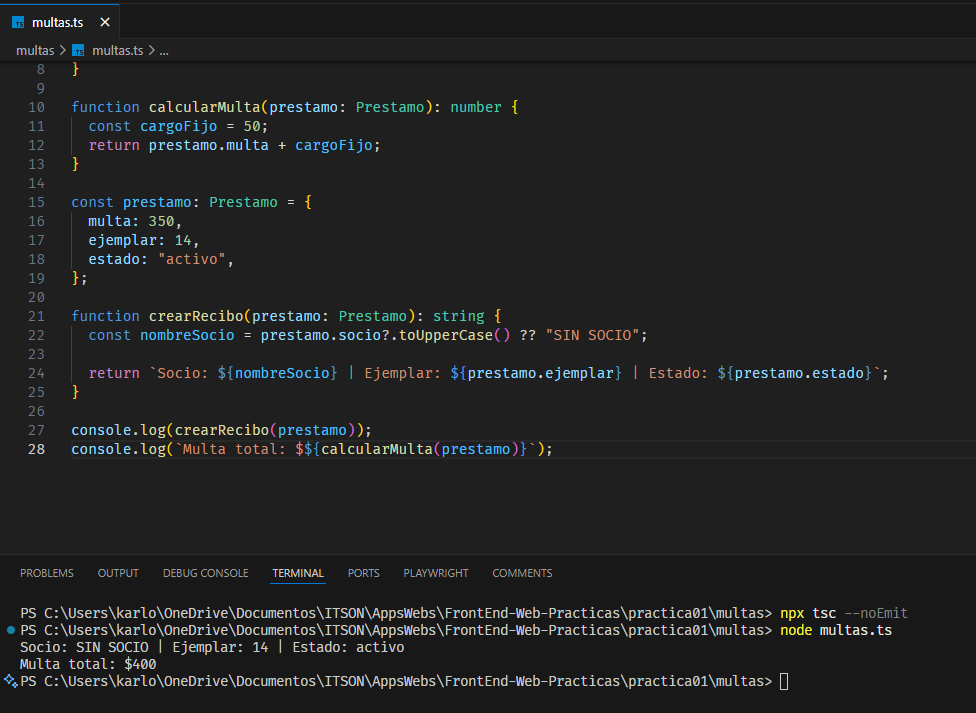
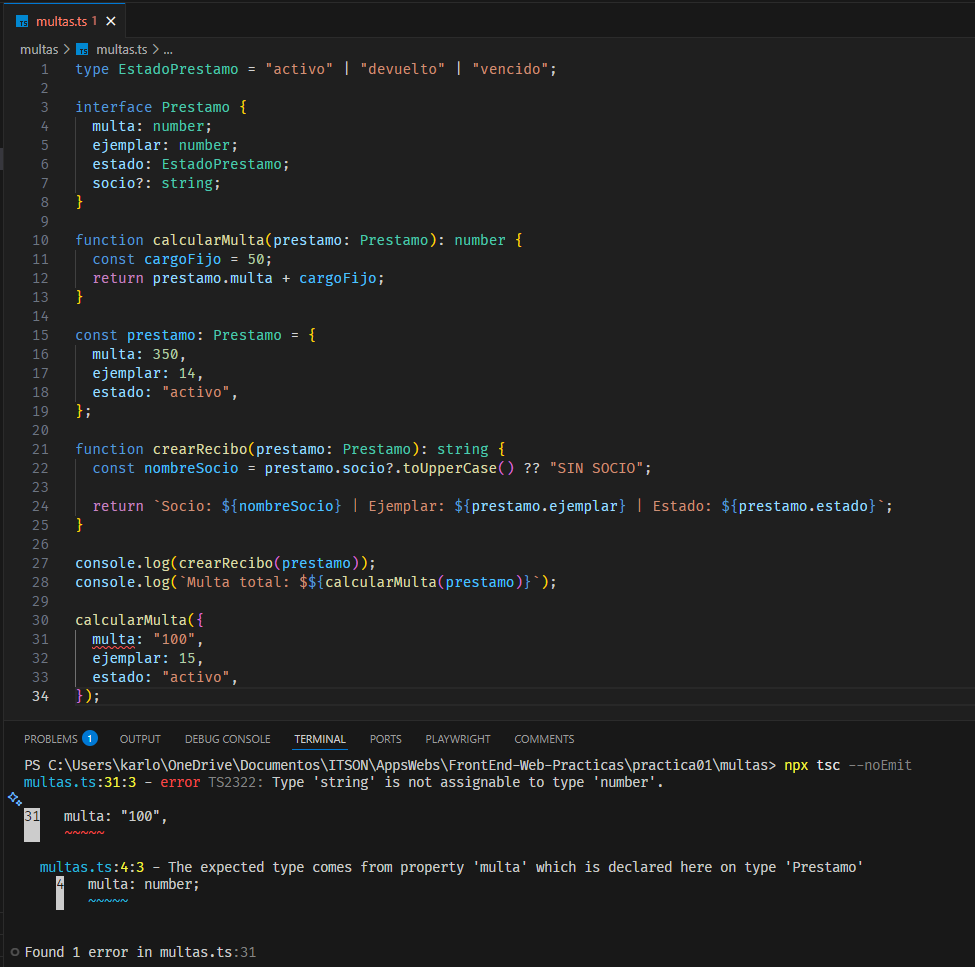
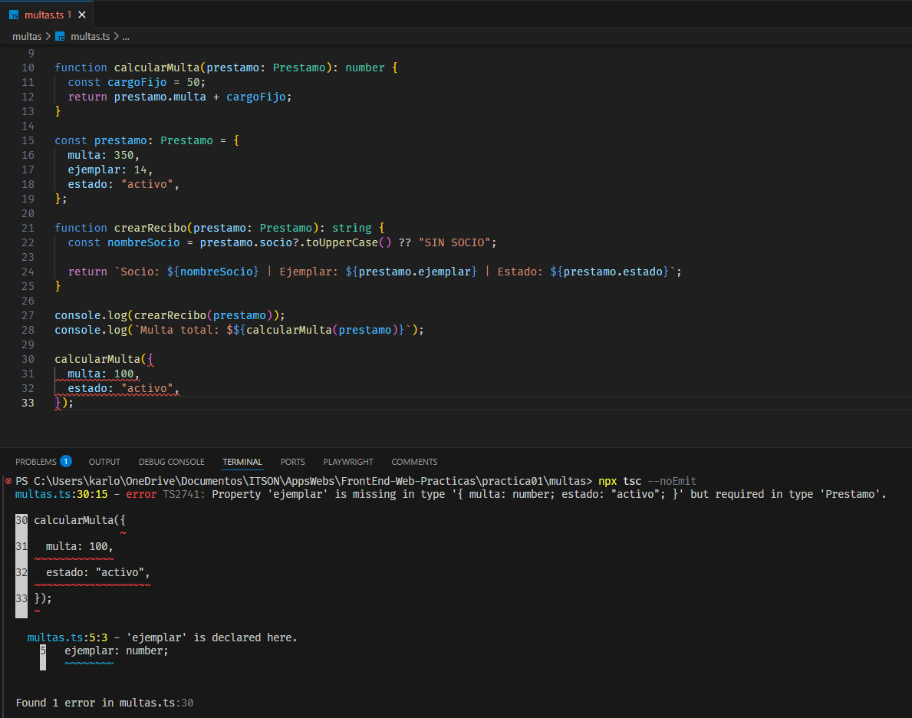
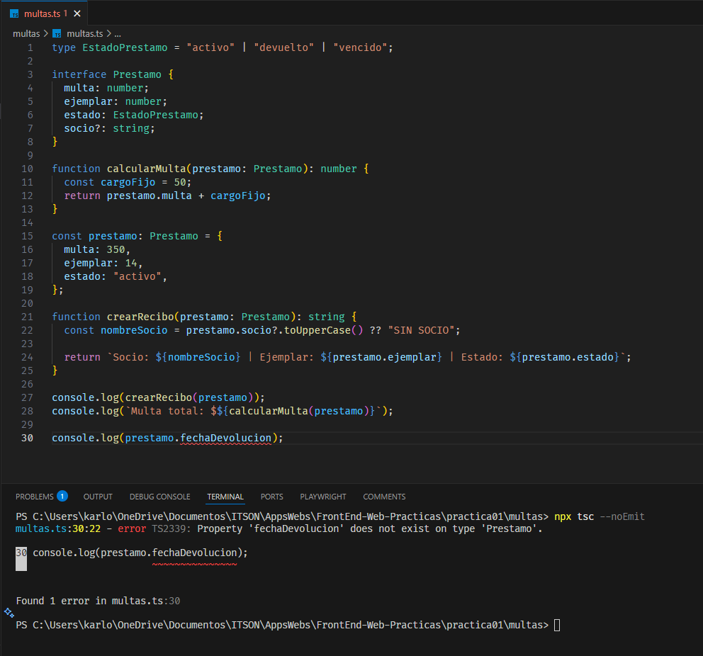

# Práctica 01 — Descubriendo TypeScript

## Objetivo

Comprobar cómo TypeScript detecta errores antes de ejecutar un programa y distinguir entre la revisión de tipos y la ejecución con Node.js.

## Ejecución

Desde la carpeta `multas`, instalar las dependencias:

```powershell
npm install
```

Revisar los tipos sin generar archivos:

```powershell
npx tsc --noEmit
```

Ejecutar el programa con Node.js 22.18 o superior:

```powershell
node multas.ts
```

## Paso 2. El error de JavaScript

### ¿Hubo algún error, advertencia o mensaje que avisara?

No. El programa imprimió `35050` sin mostrar errores ni advertencias.

La propiedad `multa` contenía el texto `"350"`. Al utilizar el operador `+` con ese texto y el número `50`, JavaScript realizó una concatenación en lugar de una suma.

Mi predicción fue que los valores se concatenarían. El programa pudo ejecutarse porque esa operación es válida en JavaScript, aunque el resultado no corresponde al cálculo esperado.

## Paso 3. Revisión de tipos y ejecución

### Si el archivo tiene un error de tipos, ¿por qué Node lo ejecuta?

Node elimina las anotaciones de tipos compatibles para ejecutar el archivo, pero no comprueba que los valores cumplan esos tipos.

Durante la prueba, TypeScript detectó que `multa` era un texto cuando debía ser un número. Sin corregirlo, ejecuté el archivo con Node y volvió a imprimir `35050`.

### ¿Cuál comando revisa y cuál ejecuta?

- `npx tsc --noEmit` revisa los tipos sin ejecutar el programa ni generar archivos.
- `node multas.ts` ejecuta el programa sin realizar la revisión de tipos de TypeScript.

El error observado fue `TS2345`: el objeto enviado a `calcularMulta` tenía `multa: string`, pero la función esperaba un `Prestamo` con `multa: number`.

## Paso 4. Variables y constantes

### ¿Por qué cambiar una propiedad de un objeto con const funciona, pero reasignar el objeto falla?

`const` impide reasignar la variable, pero no vuelve inmutables las propiedades del objeto.

Por eso esta operación fue vcálida:

```ts
libro.titulo = "Otro título";
```

En cambio, asignar otro objeto a `libro` produjo el error `TS2588`:

```ts
libro = { titulo: "Otro libro" };
```

Reasignar la constante `cargo` produjo el mismo código de error.

### Si nadie escribió que la variable con let era un número, ¿de dónde salió ese tipo?

TypeScript infirió el tipo a partir del valor inicial:

```ts
let disponibles = 3;
```

Como `3` es un número, la variable quedó con tipo `number`. Fue posible asignarle otro número, pero asignarle `"dos"` produjo el error `TS2322`.

`let` permite cambiar el valor de la variable, pero las asignaciones deben ser compatibles con su tipo.

## Paso 5. Modelo del préstamo

El estado del préstamo se restringió con una unión de valores literales:

```ts
type EstadoPrestamo = "activo" | "devuelto" | "vencido";
```

Al probar `"ACTIVO"`, TypeScript mostró el error `TS2820`, porque ese texto no pertenece a los valores permitidos.

El nombre del socio se declaró como opcional:

```ts
socio?: string;
```

Intentar utilizar directamente `prestamo.socio.toUpperCase()` produjo el error `TS18048`, porque la propiedad podría ser `undefined`.

El caso se resolvió con:

```ts
const nombreSocio = prestamo.socio?.toUpperCase() ?? "SIN SOCIO";
```

El operador `?.` evita llamar al método cuando el valor no existe. El operador `??` proporciona el texto alternativo.

Finalmente, la revisión terminó sin errores y el programa imprimió:

```text
Socio: SIN SOCIO | Ejemplar: 14 | Estado: activo
Multa total: $400
```

## Paso 6. Tres errores distintos

Las ubicaciones corresponden a las líneas de cada experimento, documentadas en las capturas.

### 1. Tipo incorrecto en multa

- **Código:** TS2322.
- **Ubicación:** `multas.ts`, línea 31, columna 3.
- **Mensaje exacto:** `Type 'string' is not assignable to type 'number'.`
- **Esperaba:** un número en la propiedad `multa`.
- **Recibió:** el texto `"100"`.
- **Corrección:** utilizar `100` sin comillas.

### 2. Propiedad obligatoria ausente

- **Código:** TS2741.
- **Ubicación:** `multas.ts`, línea 30, columna 15.
- **Mensaje exacto:** `Property 'ejemplar' is missing in type '{ multa: number; estado: "activo"; }' but required in type 'Prestamo'.`
- **Esperaba:** un objeto con las propiedades obligatorias `multa`, `ejemplar` y `estado`.
- **Recibió:** un objeto con `multa` y `estado`, sin `ejemplar`.
- **Corrección:** agregar la propiedad `ejemplar` con un valor numérico.

### 3. Propiedad inexistente

- **Código:** TS2339.
- **Ubicación:** `multas.ts`, línea 30, columna 22.
- **Mensaje exacto:** `Property 'fechaDevolucion' does not exist on type 'Prestamo'.`
- **Esperaba:** un acceso a una propiedad declarada en `Prestamo`.
- **Recibió:** un acceso a `fechaDevolucion`, que no está declarada.
- **Corrección:** retirar el acceso a esa propiedad.

Después de documentar cada experimento, se retiró el código incorrecto para dejar el programa final sin errores.

## Evidencias

### Resultado de JavaScript


### Error detectado por TypeScript


### Ejecución con el error de tipos


### Constantes e inferencia


### Estado no permitido


### Propiedad opcional


### Programa final


### Error de tipo


### Propiedad obligatoria ausente


### Propiedad inexistente
