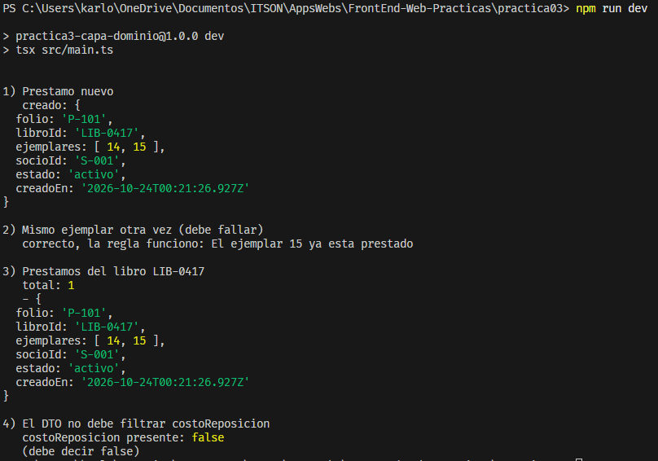
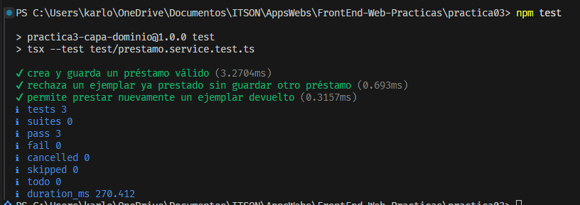
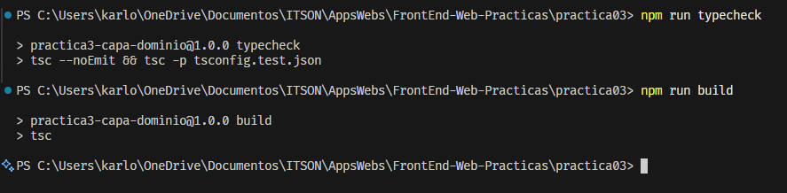

# Práctica 03 — La capa de dominio con genéricos y patrones

## Objetivo

Construir la capa de dominio de un sistema de préstamos de biblioteca utilizando genéricos y los patrones Repository, DTO y Service.

La regla principal es impedir que un ejemplar que sigue prestado se entregue en otro préstamo del mismo libro.

## Instalación y ejecución

Desde la carpeta `practica03`:

```powershell
npm install
```

Revisar los tipos de la aplicación y las pruebas:

```powershell
npm run typecheck
```

Ejecutar los escenarios:

```powershell
npm run dev
```

Ejecutar las pruebas automáticas:

```powershell
npm test
```

Compilar:

```powershell
npm run build
```

## Organización

- `src/dominio`: entidad y contratos de los repositorios.
- `src/infra`: implementación del repositorio con un `Map`.
- `src/dto`: contratos de entrada y salida y conversión de la entidad.
- `src/servicios`: reglas de negocio.
- `src/errores`: error de ejemplar prestado.
- `src/main.ts`: escenarios de comprobación.
- `test`: pruebas automáticas del servicio.
- `evidencias`: capturas de los resultados.

Se conservaron archivos HTTP y de cliente de un avance posterior. No forman parte de la ejecución ni de la compilación de esta práctica. La configuración incluye `src/main.ts` y sus dependencias; las pruebas tienen una configuración adicional.

## Implementación

### Repositorio genérico

Se declaró `Repository<T, ID = string>` con los métodos `findById`, `findAll`, `save` y `delete`.

`T` representa la entidad e `ID` representa el tipo de identificador. Todos los métodos devuelven promesas.

`PrestamoRepository` extiende `Repository<Prestamo>` y añade `findByLibro`.

### Repositorio en memoria

`InMemoryPrestamoRepository` implementa el contrato utilizando un `Map<string, Prestamo>`, con el folio como llave.

Cuando no encuentra un préstamo por folio, devuelve `null`. Las consultas de listas devuelven arreglos.

### DTO

El DTO de creación utiliza `Omit` para excluir `folio`, `creadoEn`, `estado` y `costoReposicion`. Estos datos no los establece el cliente.

El DTO de respuesta contiene los campos públicos y convierte la fecha a texto ISO. La función de conversión construye un objeto sin `costoReposicion`.

Los tipos describen contratos durante la revisión de TypeScript; por sí solos no validan datos externos durante la ejecución.

### Servicio

`PrestamoService` recibe un `PrestamoRepository` por constructor, sin importar la implementación en memoria.

Antes de guardar, consulta los préstamos del libro y obtiene los ejemplares de los préstamos activos o vencidos. Si alguno coincide con los solicitados, lanza `EjemplarPrestadoError`.

Los préstamos devueltos no bloquean sus ejemplares.

El servicio genera el folio, la fecha y el estado inicial. Para este ejercicio asigna `0` como costo de reposición inicial, ya que no se definió una regla para calcularlo.

## Resultados

Sin modificar `main.ts`, se comprobó que:

1. Un préstamo válido se crea correctamente.
2. Intentar prestar nuevamente el ejemplar 15 produce el error de dominio.
3. La consulta devuelve un solo préstamo, porque el intento rechazado no se guarda.
4. El DTO no contiene `costoReposicion`: la comprobación muestra `false`.

## Pruebas automáticas

Se implementaron tres pruebas independientes:

1. Crear y guardar un préstamo válido.
2. Rechazar un ejemplar ocupado sin guardar otro préstamo.
3. Permitir prestar nuevamente un ejemplar devuelto.

Resultado final: **3 pruebas aprobadas y 0 fallos**.

También terminaron sin errores la revisión de tipos y la compilación. Después de actualizar las dependencias, `npm audit` reportó **0 vulnerabilidades**.

## Preguntas de reflexión

### 1. ¿Hizo falta una base de datos real para probar la regla de negocio? ¿Qué dice eso sobre para qué sirve Repository?

No hizo falta. Utilicé un repositorio con un `Map` en memoria para guardar y consultar los préstamos.

Repository separa las operaciones de almacenamiento de las reglas del negocio. Por eso se puede probar el servicio sin instalar ni conectar una base de datos.

### 2. El Service recibe una interfaz de repositorio, no InMemoryPrestamoRepository. ¿Qué se rompía si usaba la clase concreta?

El programa podría funcionar pero el servicio quedaría ligado a la implementación en memoria.

Al recibir `PrestamoRepository`, solo depende de las operaciones del contrato, incluyendo `findByLibro`. Si utilizara directamente `InMemoryPrestamoRepository`, tendría que modificar esa dependencia para utilizar otra implementación.

### 3. Si cambiaran el Map por una base de datos real, ¿cuántos archivos tocarían? ¿Por qué tan pocos?

Principalmente agregaría la nueva implementación del repositorio y cambiaría el lugar donde se conecta con el servicio. También necesitaría la configuración y las dependencias de la base de datos elegida.

El servicio, los DTO y sus reglas podrían mantenerse si la nueva implementación cumple el mismo contrato. Son pocos cambios porque el acceso a los datos está separado de la lógica del negocio.

## Evidencias

### Escenarios de dominio


### Pruebas del servicio


### Verificación final
