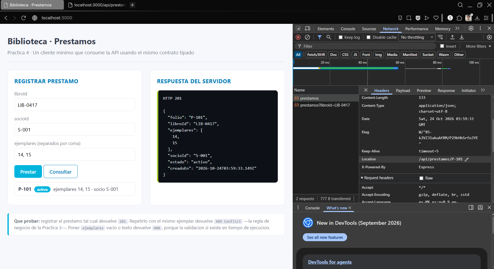
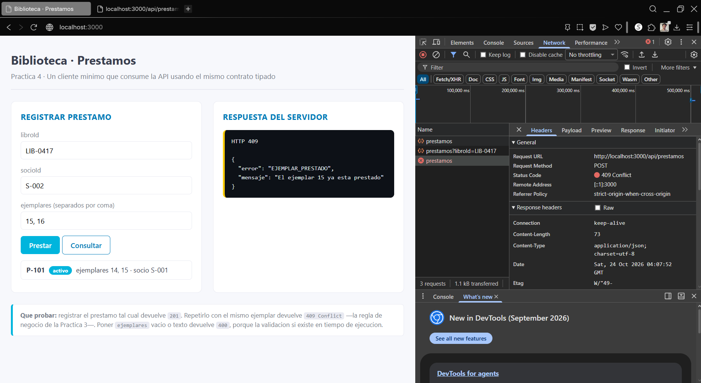
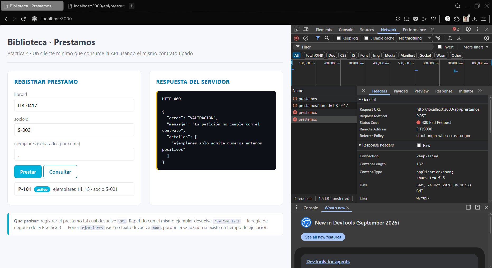
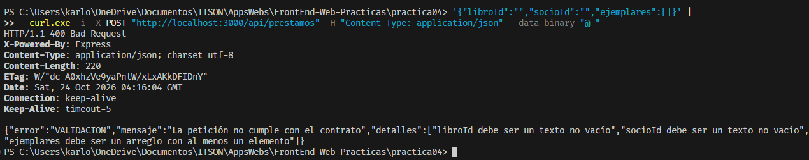
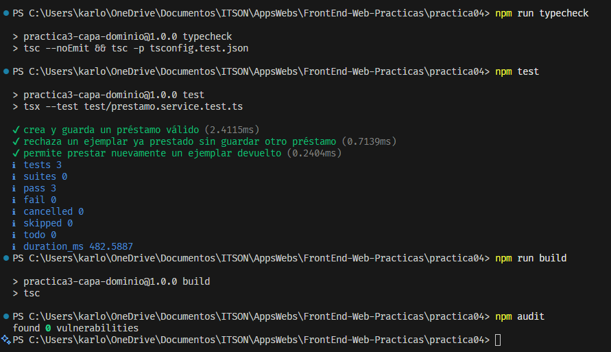

# Práctica 04 — De la capa de dominio a una API HTTP

## Objetivo

Exponer el sistema de préstamos de la práctica 03 mediante una API HTTP con Express, conservando sin modificaciones las carpetas `dominio`, `infra` y `servicios`.

## Entorno

La guía solicita Node.js 24 LTS. Esta implementación se ejecutó y verificó con Node.js 26.8.1.

Los préstamos se guardan en memoria y se pierden al reiniciar el servidor.

## Instalación y ejecución

Desde la carpeta `practica04`:

```powershell
npm install
npm run servidor
```

El comando `servidor` compila el proyecto y ejecuta `dist/http/servidor.js`.

Abrir el cliente:

```text
http://localhost:3000
```

Consultar los préstamos de un libro:

```text
http://localhost:3000/api/prestamos?libroId=LIB-0417
```

## Verificaciones

```powershell
npm run typecheck
npm test
npm run build
npm audit
```

Resultados obtenidos:

- Revisión de tipos sin errores.
- Tres pruebas del servicio aprobadas.
- Compilación sin errores.
- Auditoría con cero vulnerabilidades.

También se compararon las carpetas `dominio`, `infra` y `servicios` con las de la práctica 03, sin encontrar diferencias de contenido.

## Contrato público

El contrato incluye:

- `CrearPrestamoRequestDto`: datos enviados por el cliente.
- `PrestamoResponseDto`: datos públicos del préstamo.
- `ErrorResponseDto`: estructura de los errores.

La respuesta convierte `creadoEn` a texto ISO y deja fuera el campo interno `costoReposicion`.

Los tipos de TypeScript no validan por sí solos los datos recibidos durante la ejecución. Por eso el servidor revisa el cuerpo de la petición mediante una función que recibe `unknown`.

## Rutas y respuestas

| Método y ruta | Caso | Respuesta |
|---|---|---|
| GET `/api/prestamos?libroId=LIB-0417` | Consulta válida | 200 |
| GET `/api/prestamos` | Falta `libroId` | 400 |
| GET `/api/prestamos?libroId=` | Parámetro vacío | 400 |
| POST `/api/prestamos` | Préstamo válido | 201 |
| POST `/api/prestamos` | Ejemplar ocupado | 409 |
| POST `/api/prestamos` | Datos inválidos | 400 |

Al crear un préstamo, la respuesta incluye la cabecera `Location` con la ruta asignada al recurso, por ejemplo:

```text
Location: /api/prestamos/P-101
```

## Validación y errores

La validación comprueba que:

- `libroId` sea un texto no vacío.
- `socioId` sea un texto no vacío.
- `ejemplares` sea un arreglo no vacío con números enteros positivos.

Los errores de los campos se reúnen antes de rechazar la petición.

El middleware de errores tiene cuatro parámetros y traduce:

- `ValidacionError` a HTTP 400.
- `EjemplarPrestadoError` a HTTP 409.
- Otros errores no controlados a HTTP 500, con un mensaje general.

## Comprobaciones realizadas

### Préstamo válido: 201

Se registró un préstamo del libro `LIB-0417` para el socio `S-001`, con los ejemplares 14 y 15.

El servidor respondió 201 y devolvió el folio `P-101`, la cabecera `Location` y el DTO sin `costoReposicion`.

### Ejemplar ocupado: 409

Se intentó registrar otro préstamo del mismo libro para `S-002`, con los ejemplares 15 y 16.

El servidor respondió 409 porque el ejemplar 15 ya estaba prestado. La solicitud no agregó otro préstamo.

### Datos inválidos: 400

Al dejar vacío el campo de ejemplares, el navegador bloqueó el envío por la validación HTML.

Para comprobar la validación del servidor sin modificar el cliente, se envió una coma en ese campo. La API respondió 400 e indicó que los ejemplares deben ser números enteros positivos.

### Varios errores en una petición

Se envió directamente a la API:

```json
{
  "libroId": "",
  "socioId": "",
  "ejemplares": []
}
```

La respuesta fue 400 y reunió los tres errores dentro de `detalles`.

### Consultas GET

Se comprobó que la ausencia de `libroId` y su valor vacío producen 400. La consulta válida respondió 200 y devolvió únicamente el préstamo registrado, sin el campo interno.

## Preguntas de reflexión

### 1. Si Express no enviara automáticamente los rechazos de un handler async al middleware de errores, ¿qué habría que agregar en cada ruta?

Habría que capturar los errores con `try/catch` y enviarlos al middleware con `next(error)`, o utilizar una función envolvente que haga ese trabajo.

Así el error llegaría al manejador central, donde se decide la respuesta HTTP.

### 2. ¿Por qué el servicio no lanza directamente un 409 en lugar de EjemplarPrestadoError?

Porque el servicio contiene las reglas del negocio y no debe saber nada de la web, HTTP o REST.

`EjemplarPrestadoError` expresa que un ejemplar ya está ocupado. La capa HTTP decide representar ese problema con el código 409. Esto permite reutilizar el servicio desde otros contextos sin cambiar su lógica.

### 3. Si una app móvil también consumiera esta API, ¿qué archivos habría que tocar?

Si la app móvil utiliza las mismas operaciones y contratos, no sería necesario modificar el servicio, el repositorio ni las rutas.

Solo se tendría que desarrollar el cliente móvil para enviar las peticiones y procesar las respuestas. Para acceder desde otro dispositivo también sería necesario configurar la dirección y la disponibilidad del servidor.

## Evidencias

### Creación y cabecera Location


### Conflicto de ejemplar


### Validación del servidor


### Errores reunidos


### Verificación final
