# Práctica 06 — Conectar el dominio con la API

## Objetivo

Separar la API del gimnasio en Controller, Service y Module, y conectar el dominio de inscripciones mediante inyección de dependencias con un token.

La aplicación utiliza datos en memoria; no necesita una base de datos.

## Instalación y ejecución

Desde la carpeta `practica06`:

```powershell
npm install
npm run start:dev
```

El servidor se ejecuta en:

```text
http://localhost:3000
```

Para revisar tipos, compilar y ejecutar las pruebas:

```powershell
npx tsc --noEmit -p tsconfig.json
npm run build
npm test -- --runInBand
```

Para consultar las dependencias:

```powershell
npm audit
```

## Organización

- `src/clases`: módulo, controlador y servicio del catálogo.
- `src/inscripciones/dominio`: entidades, errores y contrato del repositorio.
- `src/inscripciones/infra`: repositorio en memoria.
- `src/inscripciones/dto`: datos de entrada y conversión de respuestas.
- `src/inscripciones/inscripciones.service.ts`: reglas de negocio.
- `src/inscripciones/inscripciones.controller.ts`: rutas y traducción de errores a HTTP.
- `src/inscripciones/inscripciones.module.ts`: registro de las dependencias.
- `inscripciones.http`: peticiones reproducibles con REST Client.
- `evidencias`: capturas de las comprobaciones.

## Separación del catálogo

El arreglo de clases y las operaciones para listar y crear se trasladaron de `AppController` a `ClasesService`.

`ClasesController` recibe el servicio por constructor y delega las operaciones. `AppController` conserva solamente la ruta raíz, evitando rutas duplicadas.

## Inyección de dependencias

Primero se inyectó directamente `InscripcionMemoriaRepository`, registrada como proveedor, y el servidor arrancó.

Después se cambió el parámetro del constructor a la interfaz `InscripcionRepository`, sin un token explícito. TypeScript compiló, pero Nest produjo:

```text
UnknownDependenciesException:
Nest can't resolve dependencies of the InscripcionesService (?).
```

Se resolvió declarando el token:

```ts
export const INSCRIPCION_REPOSITORY =
  Symbol('INSCRIPCION_REPOSITORY');
```

En el servicio se utilizó:

```ts
@Inject(INSCRIPCION_REPOSITORY)
private readonly repo: InscripcionRepository
```

En el módulo se registró:

```ts
{
  provide: INSCRIPCION_REPOSITORY,
  useClass: InscripcionMemoriaRepository,
}
```

La interfaz comprueba los tipos y el token identifica la dependencia durante la ejecución.

## Reglas de negocio

El servicio comprueba que existan el horario y el miembro.

Después considera únicamente las inscripciones confirmadas del horario para:

1. Impedir que un miembro se inscriba dos veces.
2. Impedir que se supere el cupo máximo.

Una inscripción cancelada no ocupa cupo ni bloquea una nueva inscripción.

Los errores del dominio no contienen códigos HTTP. El controlador realiza su traducción.

## Rutas

| Método | Ruta | Función |
|---|---|---|
| GET | `/clases` | Consultar el catálogo |
| POST | `/clases` | Crear una clase |
| GET | `/inscripciones` | Consultar inscripciones |
| POST | `/inscripciones` | Crear una inscripción |
| PATCH | `/inscripciones/:id/cancelar` | Cancelar una inscripción |

## Códigos de respuesta

| Código | Situación |
|---|---|
| 200 | Consulta o cancelación correcta |
| 201 | Creación de una inscripción |
| 400 | Identificadores ausentes o inválidos |
| 404 | Horario, miembro o inscripción inexistente |
| 409 | Inscripción duplicada o cupo lleno |

La creación incluye la cabecera `Location`, por ejemplo:

```text
Location: /inscripciones/1
```

Se utiliza `@Res({ passthrough: true })` para agregar la cabecera y permitir que Nest siga enviando el objeto retornado como JSON.

Las respuestas pasan por `aInscripcionDto`, que convierte la fecha a texto ISO.

## Reproducir las peticiones

1. Iniciar el servidor.
2. Abrir `inscripciones.http` con la extensión REST Client.
3. Ejecutar las peticiones en orden mediante `Send Request`.

Para repetir la secuencia completa, detener y volver a iniciar el servidor. Los datos viven en memoria y los identificadores vuelven a comenzar en 1.

La secuencia comprobada fue:

1. Inscribir al miembro 1 en el horario 1: 201.
2. Repetir al miembro 1: 409 por duplicado.
3. Inscribir al miembro 2: 201.
4. Intentar inscribir al miembro 3: 409 por cupo lleno.
5. Cancelar la inscripción 1: 200.
6. Reintentar al miembro 3: 201.

También se comprobaron las respuestas 400 por cuerpo incompleto y 404 por recursos inexistentes.

## Pruebas y verificación

Se aprobaron siete pruebas en tres archivos:

- Una prueba de delegación de `AppController`.
- Dos pruebas de `InscripcionesController`: conversión del DTO y cancelación inexistente.
- Cuatro pruebas de `InscripcionesService`: creación, duplicado, cupo lleno y liberación de cupo.

La revisión de tipos y la compilación terminaron sin errores.

Nest se actualizó a 11.2.8. Se configuró un override de Multer a 2.5.0 dentro de `@nestjs/platform-express`; después, `npm audit` reportó cero vulnerabilidades.

## Preguntas de reflexión

### 1. ¿Qué pasaría si el módulo no quedara registrado en la raíz?

Si no se importa en `AppModule` ni en otro módulo conectado con él, Nest no incorpora sus controladores y proveedores a la aplicación y sus rutas no estarían disponibles.

### 2. ¿Por qué los métodos del repositorio devuelven promesas si los datos están en memoria?

Para mantener un contrato asíncrono que también pueda implementar un repositorio con base de datos.

Así el servicio puede utilizar `await` sin depender de cómo se almacenan los datos.

### 3. ¿Qué error apareció al cambiar a la interfaz y por qué la clase sí se resolvía?

Apareció `UnknownDependenciesException`: Nest no podía resolver el primer parámetro del constructor de `InscripcionesService`.

La clase existe durante la ejecución y estaba registrada como proveedor. La interfaz desaparece al compilar, por lo que no puede identificar por sí misma la dependencia.

### 4. ¿Por qué el servicio necesita un token para el repositorio, pero el controlador no lo necesita explícitamente para el servicio?

El repositorio se solicita mediante una interfaz, que no existe durante la ejecución. Por eso necesita un token explícito.

El controlador solicita la clase `InscripcionesService`, que sí existe durante la ejecución y está registrada como proveedor. Nest utiliza esa clase como token.

### 5. ¿Cuál es la diferencia entre un 400 y un 409?

Un 400 indica que la petición no cumple con los datos requeridos, por ejemplo, que falten los identificadores.

Un 409 indica que los datos tienen una forma válida, pero la operación entra en conflicto con el estado actual del gimnasio, como una inscripción duplicada o un horario lleno.

### 6. ¿Por qué cambió el código de estado de la última petición?

La inscripción del miembro 3 primero respondió 409 porque el horario estaba lleno.

Después de cancelar la inscripción 1, quedó un lugar disponible. Al repetir la misma solicitud, el servidor respondió 201 porque ya podía crear la inscripción.

## Evidencias

### Catálogo de clases
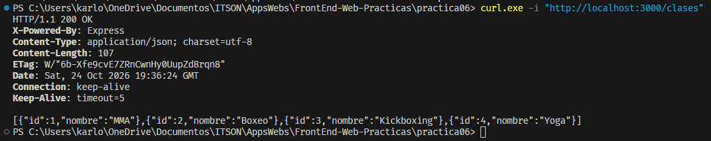

### Creación de una clase
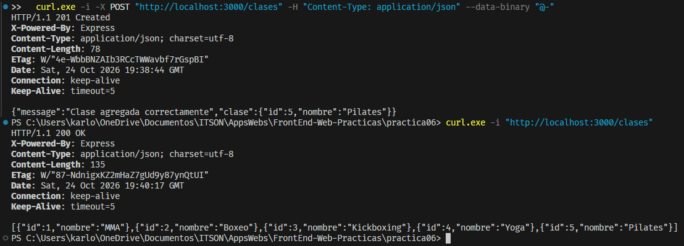

### Inyección con clase concreta
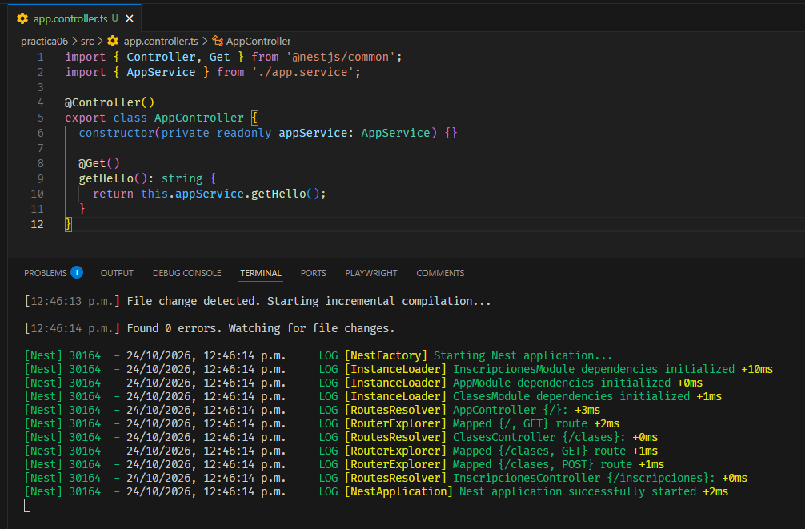

### Interfaz sin token
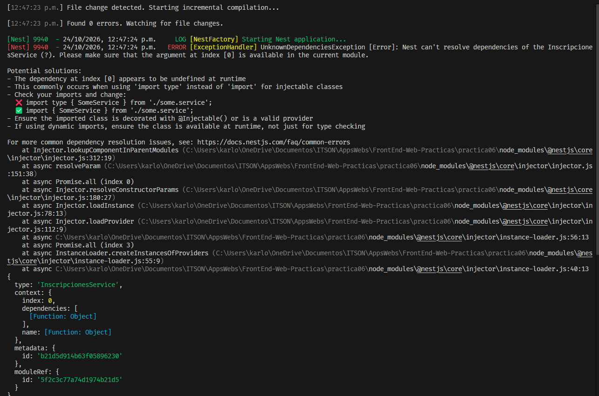

### Inyección con token
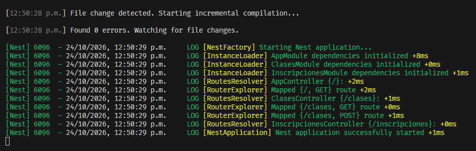

### Inscripción creada
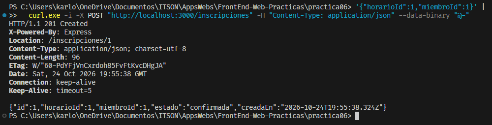

### Inscripción duplicada
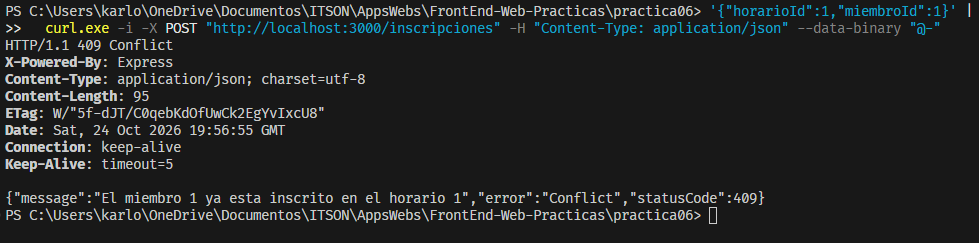

### Cupo lleno
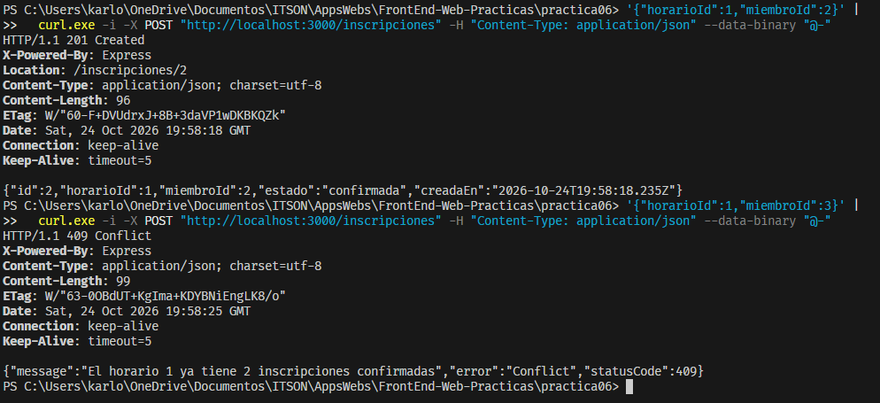

### Cancelación
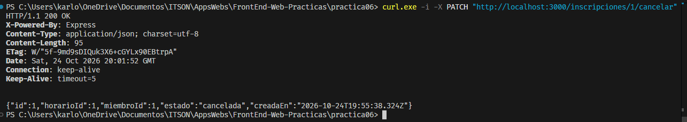

### Reintento después de cancelar
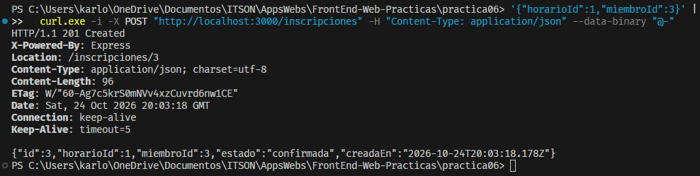

### Datos inválidos
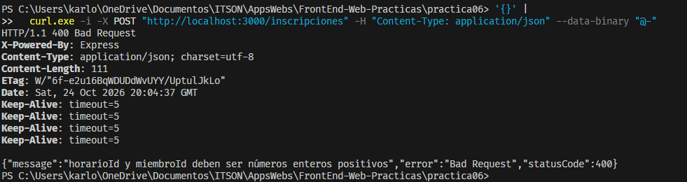

### Recursos inexistentes
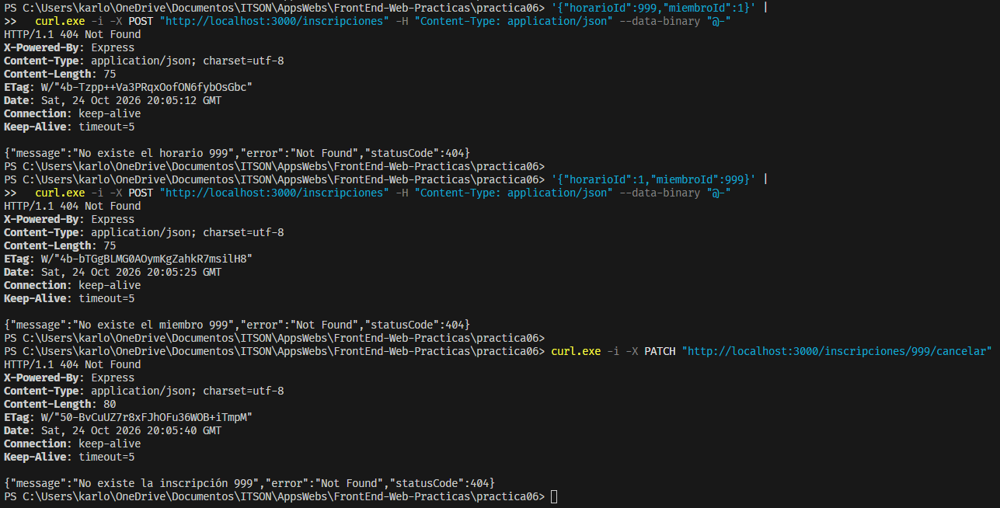

### Verificación final
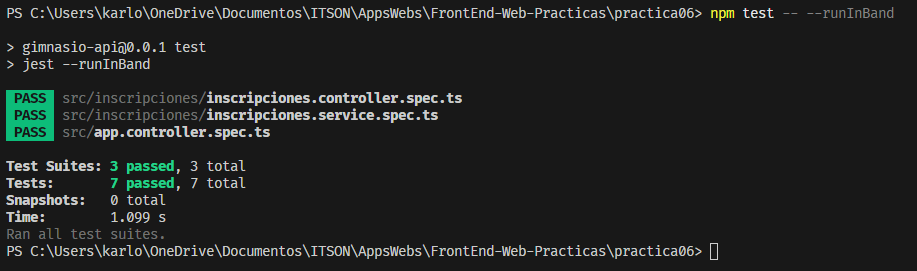