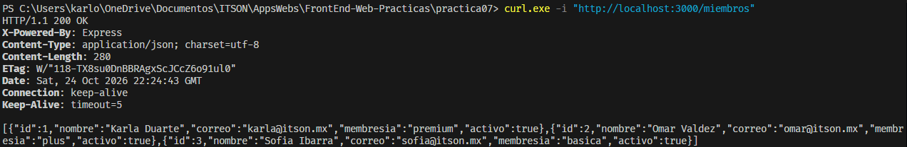
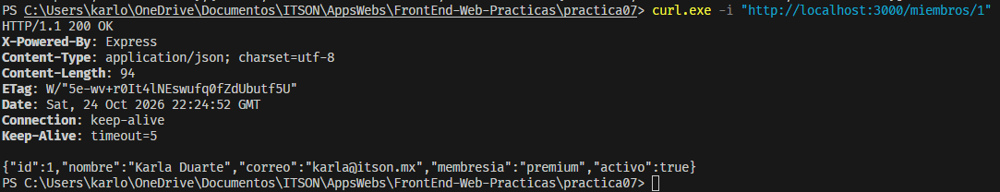
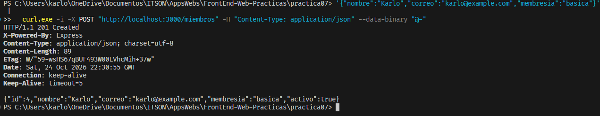
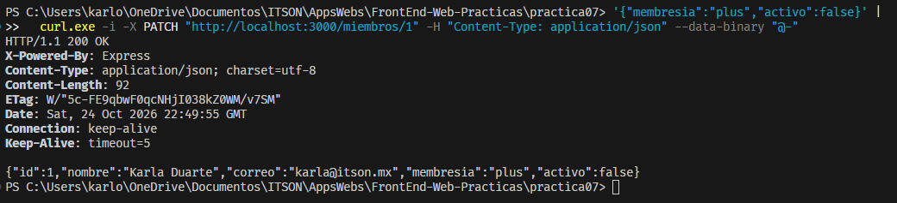
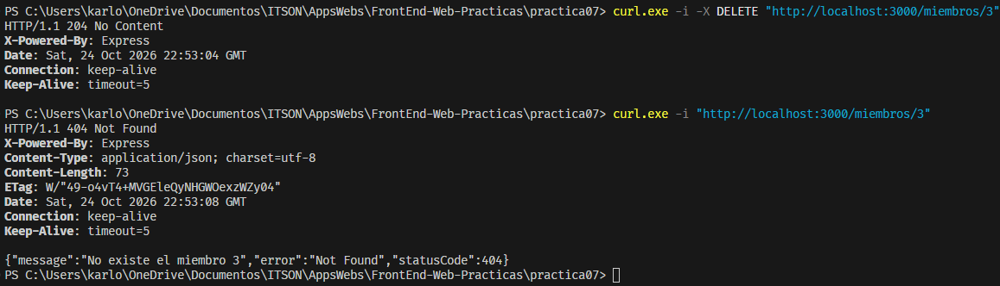
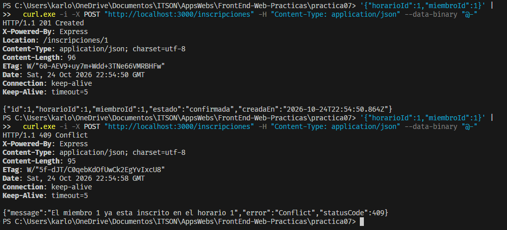
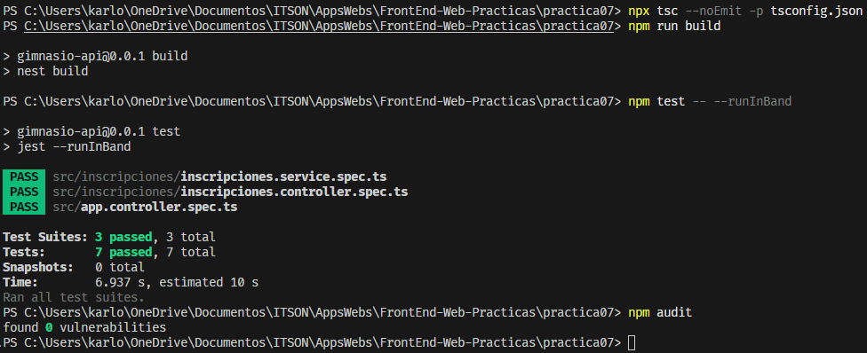
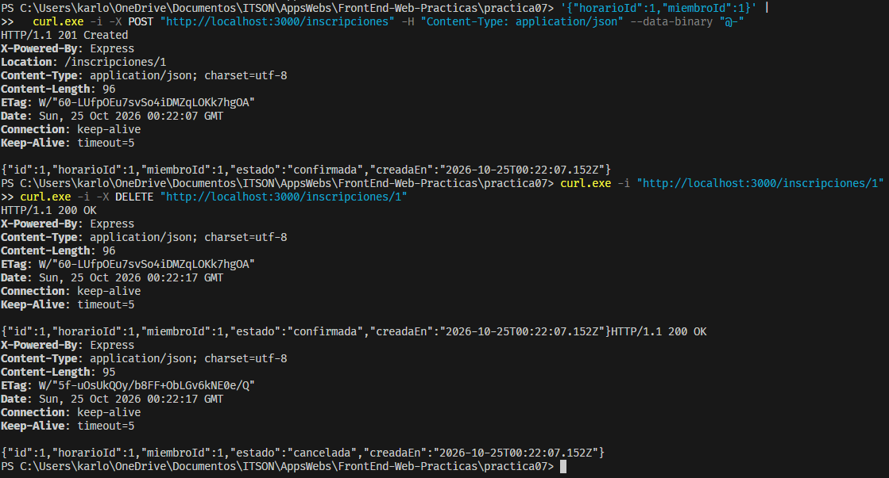

# Práctica 07 — Construir el módulo Miembros

## Objetivo

Agregar el módulo Miembros al proyecto de la práctica 06, utilizando una interfaz de repositorio, un token de inyección y las capas Repository, Service, Controller y Module.

Se conservó el módulo Inscripciones y sus reglas de duplicados y cupo.

## Instalación y ejecución

Desde la carpeta `practica07`:

```powershell
npm install
npm run start:dev
```

Servidor:

```text
http://localhost:3000
```

Para verificar el proyecto:

```powershell
npx tsc --noEmit -p tsconfig.json
npm run build
npm test -- --runInBand
npm audit
```

Los datos se almacenan en memoria y se reinician al detener y volver a iniciar el servidor.

## Organización de Miembros

- `dominio/entidades.ts`: interfaz `Miembro`.
- `dominio/miembro.repository.ts`: contrato de las cinco operaciones.
- `dto/crear-miembro.dto.ts`: datos permitidos al crear.
- `dto/actualizar-miembro.dto.ts`: campos opcionales para actualizar.
- `infra/miembro-memoria.repository.ts`: almacenamiento en un arreglo.
- `miembros.tokens.ts`: token `MIEMBRO_REPOSITORY`.
- `miembros.service.ts`: delegación al repositorio.
- `miembros.controller.ts`: rutas, validación de entrada y respuestas HTTP.
- `miembros.module.ts`: registro del controlador y los proveedores.

`MiembrosModule` se incorporó a los imports de `AppModule`.

## Datos y contratos

La entidad contiene:

```ts
interface Miembro {
  id: number;
  nombre: string;
  correo: string;
  membresia: string;
  activo: boolean;
}
```

Al crear, el cliente proporciona nombre, correo y membresía. El repositorio genera el ID y establece `activo: true`.

Al actualizar, esos campos y `activo` son opcionales. Los campos omitidos conservan sus valores.

El controlador comprueba que los campos de texto proporcionados no estén vacíos y que `activo` sea booleano. No se implementó validación del formato del correo ni un catálogo cerrado de membresías.

## Repositorio e inyección

`MiembroMemoriaRepository` utiliza `implements MiembroRepository` para comprobar que cumple el contrato.

El servicio recibe la interfaz mediante:

```ts
@Inject(MIEMBRO_REPOSITORY)
private readonly repo: MiembroRepository
```

El módulo conecta el token con la implementación:

```ts
{
  provide: MIEMBRO_REPOSITORY,
  useClass: MiembroMemoriaRepository,
}
```

Los tres miembros iniciales coinciden con los datos conocidos de Inscripciones. Sin embargo, ambos repositorios mantienen almacenamientos independientes: los cambios realizados en Miembros no actualizan el arreglo utilizado por Inscripciones.

## Rutas

| Método | Ruta | Resultado |
|---|---|---|
| GET | `/miembros` | 200 con la lista |
| GET | `/miembros/:id` | 200 con el miembro o 404 |
| POST | `/miembros` | 201 con el miembro creado |
| PATCH | `/miembros/:id` | 200 con el miembro actualizado o 404 |
| DELETE | `/miembros/:id` | 204 sin cuerpo o 404 |

Los identificadores inválidos y los cuerpos que no cumplen la validación responden 400.

## Comprobaciones HTTP

1. Se consultaron los tres miembros iniciales.
2. Se buscó a Karla Duarte mediante el ID 1.
3. Se creó a Karlo con ID 4 y `activo: true`.
4. Se actualizó parcialmente a Karla: membresía `plus` y `activo: false`, conservando nombre y correo.
5. Se eliminó al miembro 3 con respuesta 204. La búsqueda posterior respondió 404.

También se creó una inscripción con respuesta 201 y se repitió la solicitud, obteniendo 409 por duplicado.

## Peticiones reproducibles

- `miembros.http`: operaciones de Miembros.
- `inscripciones.http`: secuencia de Inscripciones heredada de la práctica 06.

Se pueden ejecutar con la extensión REST Client.

Para repetir una secuencia desde sus datos iniciales, reiniciar primero el servidor y ejecutar las peticiones en orden.

## Verificación final

- Revisión de tipos sin errores.
- Compilación sin errores.
- Siete pruebas heredadas aprobadas.
- Auditoría con cero vulnerabilidades.
- Cinco operaciones de Miembros comprobadas mediante HTTP.

Las pruebas automáticas heredadas cubren AppController e Inscripciones; no constituyen pruebas automáticas del CRUD de Miembros.

## Preguntas de reflexión

### 1. ¿Por qué la interfaz del repositorio no menciona Express, NestJS ni memoria?

Porque describe las operaciones que necesita el sistema, no la tecnología utilizada para ejecutarlas.

La misma interfaz puede tener una implementación en memoria o con una base de datos sin cambiar el contrato que utiliza el servicio.

### 2. ¿Qué palabra de la clase promete cumplir la interfaz?

La palabra `implements`.

En este caso, `MiembroMemoriaRepository implements MiembroRepository` permite que TypeScript compruebe los métodos y sus tipos.

### 3. ¿Por qué el Service no sabe qué es una petición HTTP?

Porque recibe identificadores y datos tipados, y delega las operaciones al repositorio. No trabaja con rutas, objetos de petición ni códigos de respuesta.

El controlador es quien conecta esas operaciones con HTTP.

### 4. ¿Por qué el Service se inyecta sin token explícito en el Controller, pero el repositorio necesita uno?

`MiembrosService` es una clase que existe durante la ejecución. Nest puede utilizar esa clase como token.

`MiembroRepository` es una interfaz y desaparece al compilar. Por eso se utiliza `MIEMBRO_REPOSITORY` para identificar el proveedor durante la ejecución.

### 5. ¿Qué prueba que agregar Miembros no rompió Inscripciones?

Después de incorporar el módulo, se creó una inscripción mediante HTTP y se obtuvo 201. Al repetirla, el servidor respondió 409 por duplicado.

Además, continuaron pasando las pruebas automáticas anteriores, incluyendo las reglas de duplicado, cupo lleno y liberación de cupo al cancelar.

Estas comprobaciones aportan evidencia sobre los comportamientos probados, aunque no garantizan por sí solas la ausencia de cualquier otro defecto.

## Evidencias

### Listar


### Buscar


### Crear


### Actualizar


### Eliminar


### Regresión de Inscripciones


### Verificación final

## Consulta y cancelación de inscripciones

`GET /inscripciones/:id` devuelve el DTO de una inscripción o 404 si no existe. `DELETE /inscripciones/:id` cancela la inscripción y devuelve 200 con su estado `cancelada`; no elimina el registro. Los identificadores no enteros o no positivos responden 400.

Las pruebas HTTP automatizadas verifican búsqueda, Location, duplicados, cupo, cancelación, liberación de cupo e identificadores inválidos. Se ejecutan con:

```powershell
npm run test:e2e -- --runInBand
```

### Consulta y cancelación de inscripciones

