# Práctica 09 — Blindar la API

## Objetivo

Conectar los cuatro repositorios del gimnasio a MySQL mediante Prisma y agregar validación global, traducción centralizada de errores de dominio y configuración de CORS.

## Requisitos

- Node.js compatible con las dependencias instaladas.
- MySQL 8 funcionando.
- Visual Studio Code y la extensión REST Client.
- Credenciales locales con permisos para utilizar la base de datos.

## Instalación y ejecución

Desde la carpeta `practica09`:

```powershell
npm install
Copy-Item .env.example .env
```

Editar `.env` con las credenciales locales. No compartir ni subir ese archivo.

Para una base nueva:

```powershell
npx prisma migrate deploy
```

Si se utiliza la base de la práctica 08, comprobar su estado:

```powershell
npx prisma migrate status
```

Generar el cliente e iniciar la aplicación:

```powershell
npx prisma generate
npm run build
npm run start:dev
```

Servidor:

```text
http://localhost:3000
```

Los datos se conservan en MySQL después de reiniciar el servidor.

## Configuración de Prisma

`PrismaService` utiliza `PrismaMariaDb` como adaptador y obtiene la conexión desde `DATABASE_URL`.

`PrismaModule` está registrado en `AppModule`, marcado con `@Global()` y exporta `PrismaService`.

Los repositorios implementan los mismos contratos que sus versiones en memoria:

- `ClasePrismaRepository`.
- `HorarioPrismaRepository`.
- `MiembroPrismaRepository`.
- `InscripcionPrismaRepository`.

Los módulos conectan cada token con su implementación mediante `useClass`. Se retiraron los cuatro repositorios en memoria.

Las reglas de cupo y duplicados permanecen en `InscripcionesService`.

## Inscripciones y restricción única

La base impide repetir la combinación de horario y miembro.

Cuando se solicita nuevamente una inscripción cancelada, el repositorio reactiva su fila. Conserva el ID y la fecha original, sin crear una fila duplicada.

El modelo actual no conserva un registro independiente de cada reinscripción.

Cancelar utiliza:

```text
DELETE /inscripciones/:id
```

La operación cambia el estado a `cancelada`; no elimina físicamente la inscripción.

## Validación

Los DTO de creación son clases con decoradores de `class-validator`.

Se validan, entre otros:

- Identificadores y cupos enteros positivos.
- Textos obligatorios y longitudes máximas.
- Hora con formato `HH:mm`.
- Correo válido.
- Membresía dentro de `basica`, `plus` y `premium`.

Los DTO de actualización utilizan `PartialType` para conservar las reglas con campos opcionales.

El pipe global utiliza:

```ts
new ValidationPipe({
  whitelist: true,
  forbidNonWhitelisted: true,
  transform: true,
  transformOptions: {
    enableImplicitConversion: true,
  },
})
```

La conversión implícita puede convertir un texto numérico a número. Por eso se probó `"hola"` como identificador inválido.

Los controladores importan las clases DTO como valores, no mediante `import type`, para que Nest disponga de ellas durante la ejecución.

## Filtro de errores de dominio

Los errores específicos heredan de `ErrorDominio`.

`DominioFilter` captura esa clase base y responde:

| Error | Código |
|---|---|
| HorarioNoEncontradoError | 404 |
| MiembroNoEncontradoError | 404 |
| CupoLlenoError | 409 |
| InscripcionDuplicadaError | 409 |

La estructura de estos errores incluye:

```json
{
  "statusCode": 409,
  "error": "InscripcionDuplicadaError",
  "message": "Descripción del conflicto",
  "path": "/inscripciones",
  "timestamp": "Fecha ISO"
}
```

Las excepciones HTTP de Nest, incluyendo las de validación, conservan su respuesta habitual.

Se retiró del controlador la validación manual de los identificadores del cuerpo y el bloque que traducía los errores del servicio.

## CORS

Se permiten únicamente estos orígenes de desarrollo:

```text
http://localhost:5173
http://127.0.0.1:5173
```

Se exponen las cabeceras `Location` y `X-Request-Id`, cuando estén presentes. Esta configuración no genera por sí misma un identificador de petición.

Se compararon respuestas para orígenes permitidos y para `http://localhost:9999`, no permitido.

Los permitidos reciben `Access-Control-Allow-Origin`; el no permitido no recibe esa cabecera.

## Peticiones reproducibles

Abrir `peticiones.http` con REST Client y ejecutar los bloques en orden con `Send Request`.

El archivo contiene 36 bloques que cubren:

- CRUD de Clases, Horarios y Miembros.
- Creación, consulta y cancelación de Inscripciones.
- Conflictos de duplicado y cupo.
- Liberación de cupo tras cancelar.
- Validación de tipos, campos adicionales, correo y membresía.
- Errores de recursos inexistentes.
- CORS con dos orígenes permitidos y uno no permitido.
- Limpieza de los datos creados por la secuencia.

Las peticiones nombradas permiten obtener los ID desde las respuestas, sin asumir identificadores fijos. Los correos de prueba utilizan identificadores generados por REST Client.

Los bloques 32 al 36 eliminan los recursos creados por esa ejecución. Eliminar el horario también elimina sus inscripciones por las relaciones configuradas con `Cascade`.

Reiniciar el servidor no vacía la base de datos.

## Resultados de verificación

```powershell
npx prisma validate
npx prisma migrate status
npx prisma generate
npm run build
npm audit
```

Resultados:

- Esquema válido.
- Cinco migraciones aplicadas y ninguna pendiente.
- Cliente Prisma 7.10.1 generado.
- Compilación sin errores.
- Cero vulnerabilidades reportadas por npm.
- Los 36 bloques de peticiones respondieron según lo esperado.

Estas comprobaciones HTTP se realizaron manualmente con REST Client; no se presentan como pruebas automatizadas.

## Preguntas de reflexión

### 1. ¿Qué línea del Service o del Controller tuvo que cambiar para que Clases hablara con MySQL?

Ninguna. Se creó el repositorio Prisma y se cambió la implementación registrada en `ClasesModule`.

El servicio continuó utilizando el mismo contrato y el controlador conservó sus rutas.

### 2. ¿Por qué InscripcionesService no tuvo que cambiar las reglas de cupo y duplicados?

Porque las reglas dependen de las operaciones del contrato del repositorio, no de un arreglo ni de consultas SQL.

El nuevo repositorio obtiene los datos desde MySQL, pero los devuelve con la forma que el servicio ya esperaba.

### 3. ¿Por qué una interfaz no puede validar datos durante la ejecución?

Porque desaparece al compilar. Sirve para revisar el código durante el desarrollo, pero no comprueba el JSON enviado por un cliente.

Las clases DTO y sus decoradores permiten que el pipe revise los valores durante la ejecución.

### 4. ¿Qué código y cuerpo devuelve la validación?

Devuelve 400 Bad Request.

El cuerpo incluye `statusCode: 400`, `error: "Bad Request"` y un arreglo `message` con los errores encontrados. Se comprobó con un identificador inválido y con un campo no permitido.

### 5. ¿Cuántas líneas más corto quedó el controlador?

Pasó de 81 a 61 líneas: quedó 20 líneas más corto.

La validación se realiza en el pipe y la traducción de los errores de dominio en el filtro.

### 6. Si la respuesta llega con ambos orígenes, ¿quién bloquea y a quién protege CORS?

El navegador aplica CORS y decide si el JavaScript de una página puede leer la respuesta de otro origen.

Con curl se pudieron leer ambas respuestas porque curl no aplica esa restricción. CORS protege el acceso desde páginas de otros orígenes; no sustituye la autenticación ni impide por sí solo que una petición llegue al servidor.

## Evidencias

### Clases mediante la API
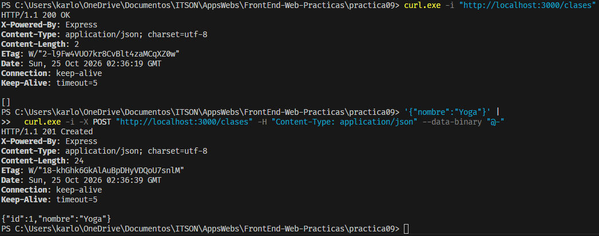

### Clases en MySQL
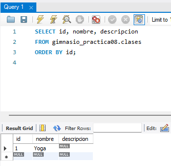

### Persistencia tras reiniciar
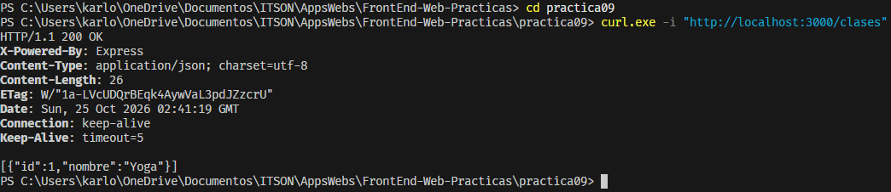

### Horarios mediante la API
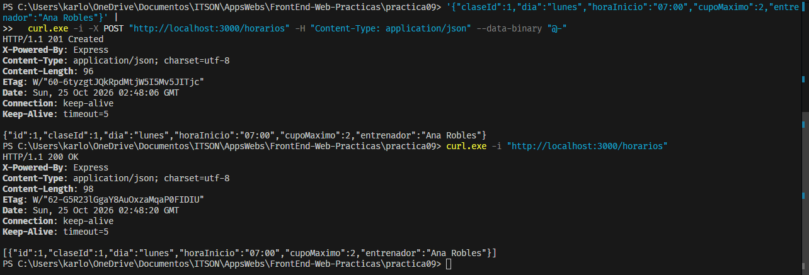

### Horarios en MySQL
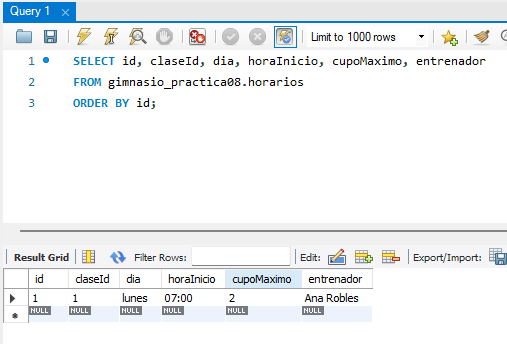

### Miembros mediante la API
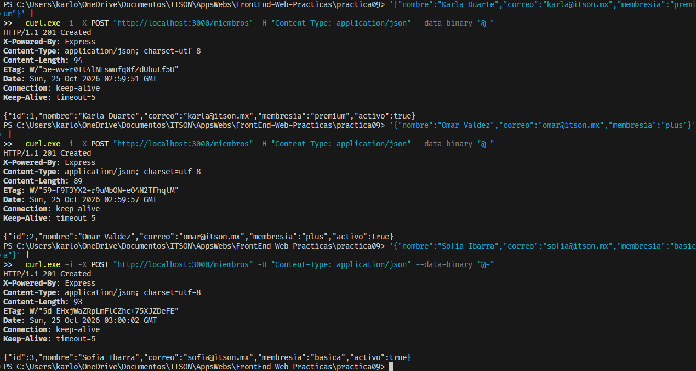

### Miembros en MySQL
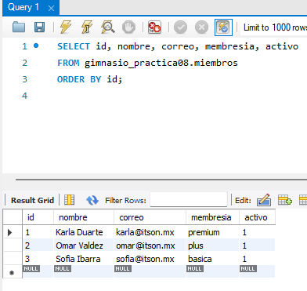

### Inscripción mediante la API
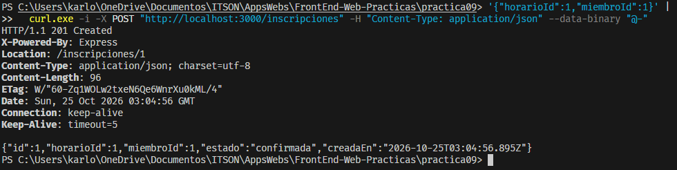

### Inscripción en MySQL
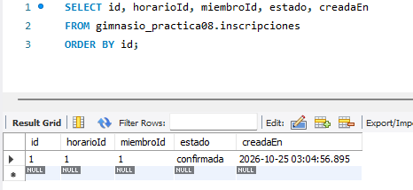

### Regla de duplicados
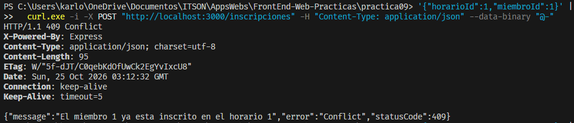

### Regla de cupo
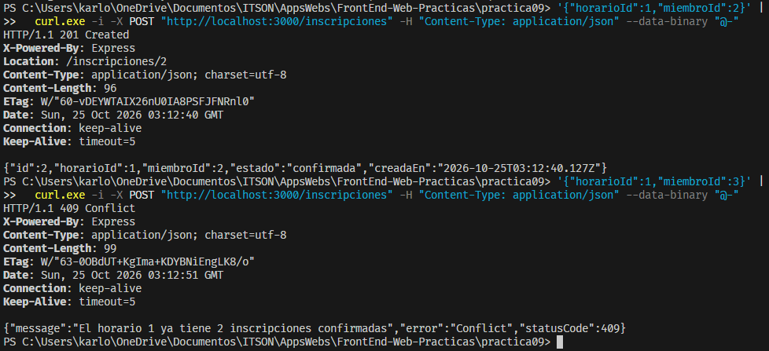

### Validación de tipos
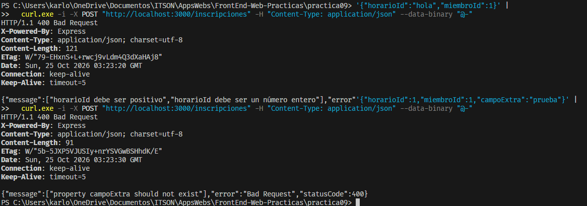

### Campo adicional
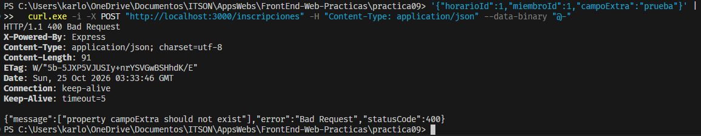

### Duplicado traducido por el filtro
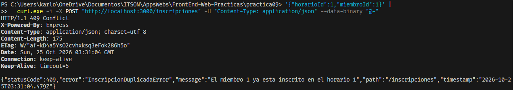

### Cupo traducido por el filtro
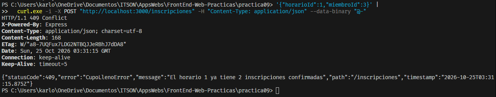

### CORS permitido
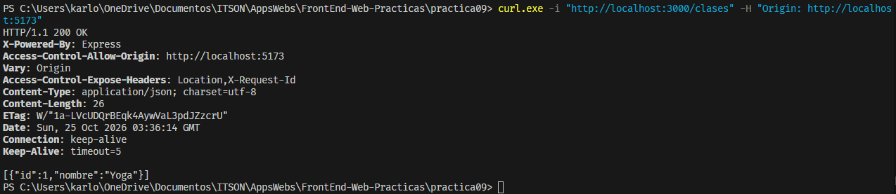

### CORS no permitido
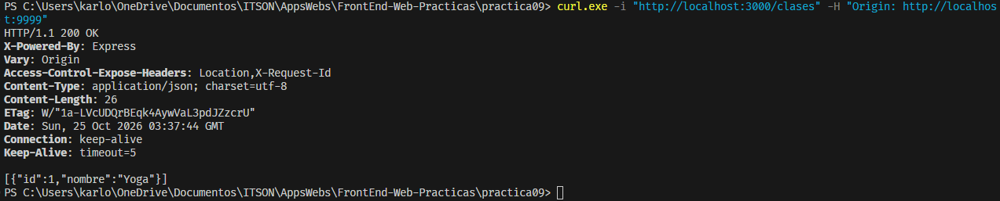

### Segundo origen permitido
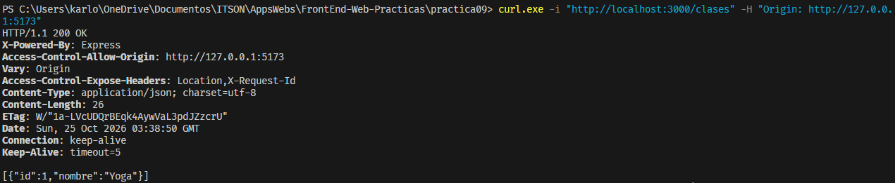

### Inexistencia traducida por el filtro
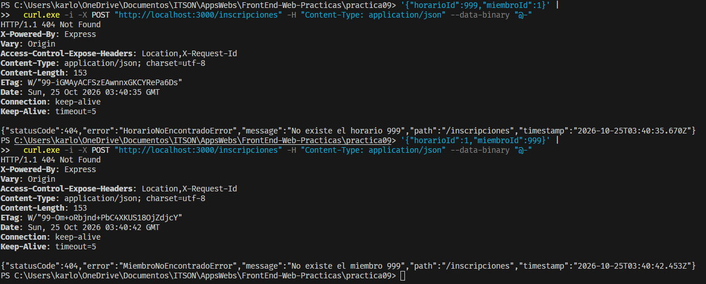

### Cancelación y reinscripción
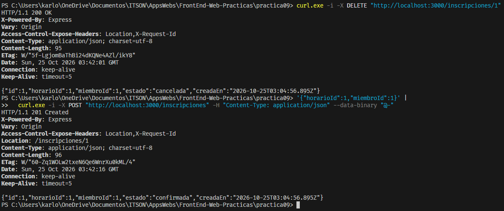

### Verificación final
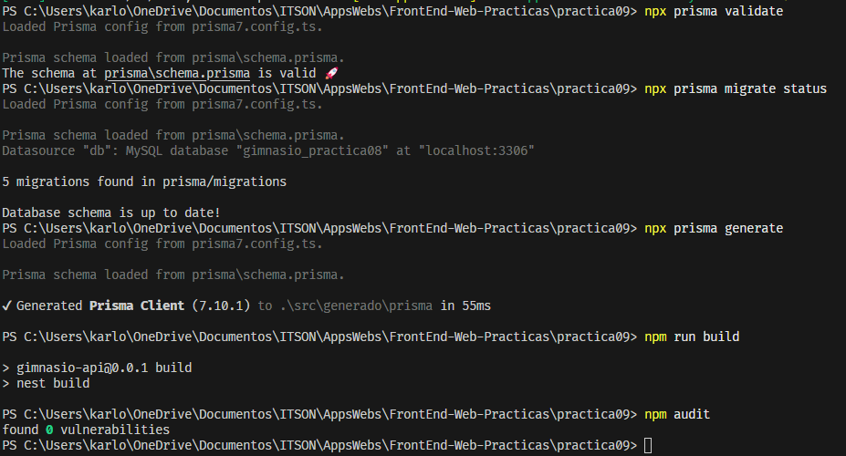