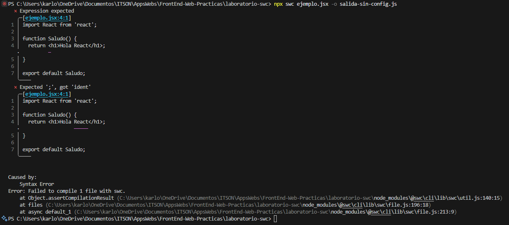
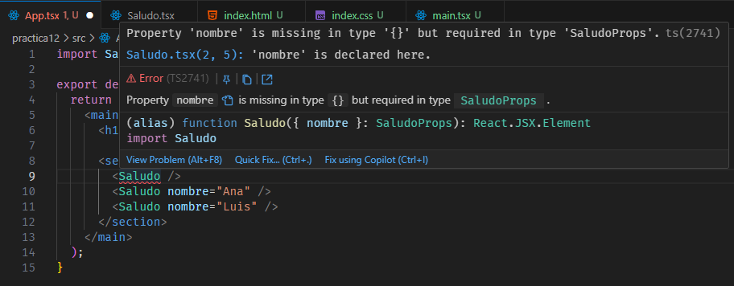

# Práctica 12 — Hola React

## Francisco Javier Sanchez Lopez 
## ID 00000164512
## Objetivo de la practica
  Entender qué es React por dentro (una biblioteca de funciones y un compilador que traduce el JSX), crear el primer proyecto con Vite y construir componentes sencillos que reciben datos por props.

## Como instalar y ejecutar la aplicacion
  npm install
  npm run dev

## 1. ¿En qué se convirtió cada etiqueta del JSX? Si React es "sólo una biblioteca", ¿quién traduce el JSX?

En el modo clásico de SWC, las etiquetas JSX se transformaron en llamadas a `React.createElement`. Por ejemplo:
```jsx
<h1>Hola React</h1>
```
Se convirtió en una expresión:

```js
React.createElement("h1", null, "Hola React");
```

En el modo automático, las etiquetas se transformaron en llamadas a funciones como `jsx` o `jsxs`, importadas desde `react/jsx-runtime`. Para el mismo ejemplo, se ve asi:
```js
_jsx("h1", { children: "Hola React" });
```
Los dos modos producen código JavaScript que describe los elementos de la interfaz. La diferencia principal es la función utilizada para crear esas descripciones.

El JSX es traducido por una herramienta de transformación de código. En esta practica, esa herramienta fue SWC.

React trabaja con el resultado de esa transformación. El navegador no interpreta directamente JSX; necesita recibir el JavaScript generado por las herramientas del proyecto.

Al intentar compilar sin habilitar JSX, SWC no pudo interpretar correctamente la sintaxis de las etiquetas.

**Mensaje observado en mi consola:**

Error: Failes to compile 1 file with swc.
  at Object.assertCompilationResult(C:Users\karlo\OneDrive\Documentos\ITSON\AppsWebs\FrontEnd-Web-Practicas\laboratorio-swc\node_modules\@swc\cli\lib\swc\util.js:140:15)
  at files (C:Users\karlo\OneDrive\Documentos\ITSON\AppsWebs\FrontEnd-Web-Practicas\laboratorio-swc\node_modules\@swc\cli\lib\swc\file.js:196:18)
  at async default_1 (C:Users\karlo\OneDrive\Documentos\ITSON\AppsWebs\FrontEnd-Web-Practicas\laboratorio-swc\node_modules\@swc\cli\lib\swc\file.js:213:9)

Después de habilitar el reconocimiento de JSX en la configuración, fue posible transformar el archivo.

## 2. ¿Dónde está el contenedor vacío y quién lo llena?

El contenedor está en `index.html`:

```html
<div id="root"></div>
```

El archivo `src/main.tsx` obtiene ese elemento mediante `document.getElementById('root')`. Después, React DOM utiliza `createRoot` y `render` para mostrar la aplicación dentro de él.

## 3. ¿Qué hace createRoot y qué hace render?

`createRoot` crea una raíz de React asociada con un elemento del DOM del navegador. Esa raíz permite que React gestione el contenido del contenedor.

`render` indica qué contenido debe mostrar React dentro de esa raíz. Por ejemplo:

```tsx
const raiz = createRoot(contenedor);
raiz.render(<App />);
```

La primera instrucción crea la raíz y la segunda solicita que se muestre el componente `App`.


## 4. ¿Qué ocurrió al quitar la prop obligatoria? ¿Por qué el nombre de un componente empieza con mayúscula?

La interfaz de TypeScript definía `nombre` como una propiedad obligatoria de tipo `string`:

```tsx
interface SaludoProps {
  nombre: string;
}
```

Al utilizar `<Saludo />` sin proporcionar `nombre`, el editor señaló que faltaba una propiedad requerida.

**Mensaje observado en mi editor:**


Esto ocurre porque el uso del componente no cumple con la interfaz definida. Se corrigió proporcionando la prop:

```tsx
<Saludo nombre="Javi" />
```

En JSX, los nombres que comienzan con minúscula se interpretan como etiquetas del navegador, por ejemplo, `<div>` o `<h1>`.

Los nombres que comienzan con mayúscula se interpretan como referencias a componentes definidos en el código, por ejemplo, `<Saludo />`. Por eso los componentes propios deben comenzar con mayúscula.


/////////////////////////////////////////////////////////////////////////////////////////////////////////////////////////////

# React + TypeScript + Vite

This template provides a minimal setup to get React working in Vite with HMR and some Oxlint rules.

Currently, two official plugins are available:

- [@vitejs/plugin-react](https://github.com/vitejs/vite-plugin-react/blob/main/packages/plugin-react) uses [Oxc](https://oxc.rs)
- [@vitejs/plugin-react-swc](https://github.com/vitejs/vite-plugin-react/blob/main/packages/plugin-react-swc) uses [SWC](https://swc.rs/)

## React Compiler

The React Compiler is not enabled on this template because of its impact on dev & build performances. To add it, see [this documentation](https://react.dev/learn/react-compiler/installation).

## Expanding the Oxlint configuration

If you are developing a production application, we recommend enabling type-aware lint rules by installing `oxlint-tsgolint` and editing `.oxlintrc.json`:

```json
{
  "$schema": "./node_modules/oxlint/configuration_schema.json",
  "plugins": ["react", "typescript", "oxc"],
  "options": {
    "typeAware": true
  },
  "rules": {
    "react/rules-of-hooks": "error",
    "react/only-export-components": ["warn", { "allowConstantExport": true }]
  }
}
```

See the [Oxlint rules documentation](https://oxc.rs/docs/guide/usage/linter/rules) for the full list of rules and categories.
