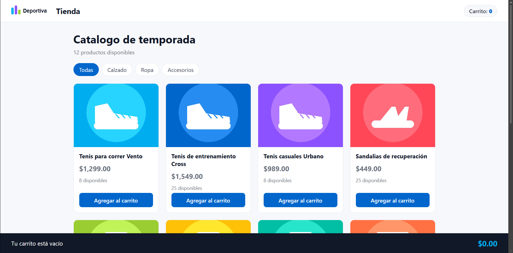
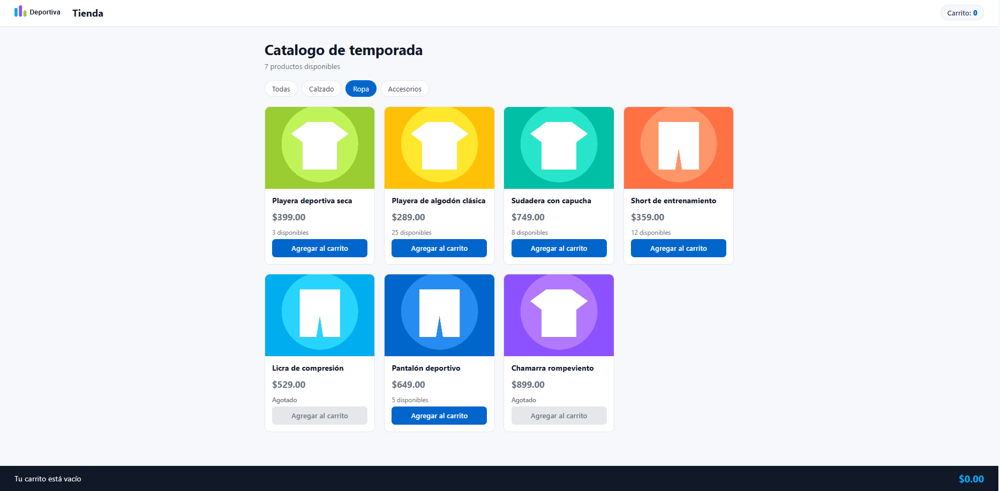
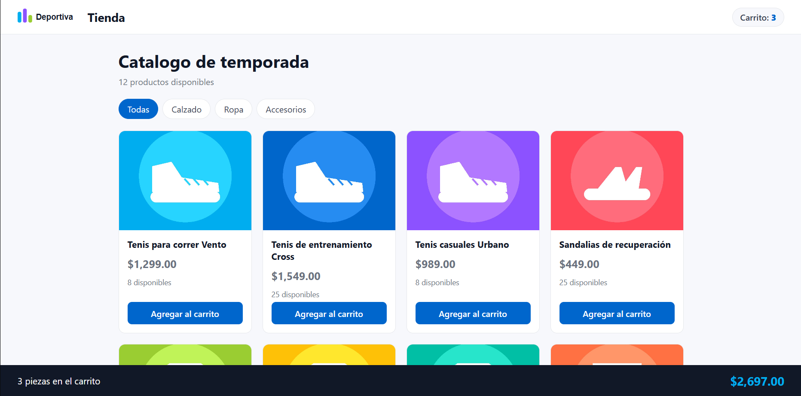
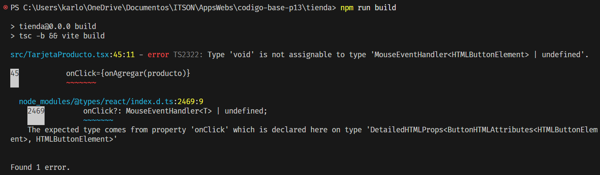
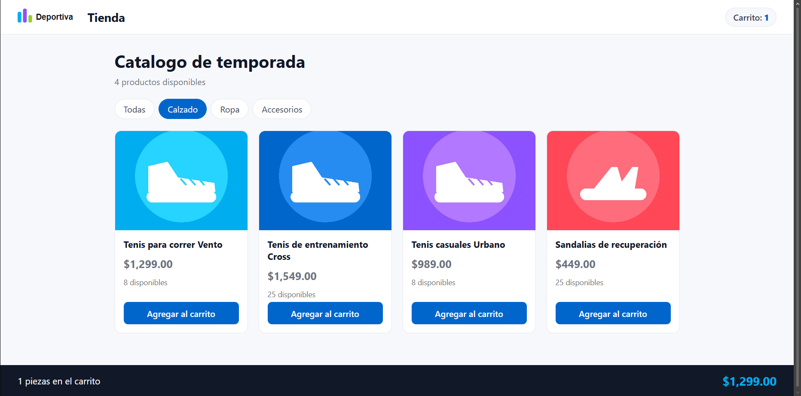

# Práctica 13 — La tienda

## Objetivo

Construir una tienda con React y TypeScript utilizando composición de componentes, props, eventos y estado. La aplicación permite consultar productos, filtrarlos por categoría y agregarlos a un carrito.

## Ejecutar el proyecto

Desde la carpeta del proyecto:

```powershell
npm install
npm run dev
```

Para comprobar los tipos y generar la versión de producción:

```powershell
npm run build
```

Los productos se encuentran en un arreglo en memoria. No se utiliza una API y el carrito se reinicia al recargar la página.

## ¿Por qué el Layout no necesita saber que es una tienda?

Porque su responsabilidad es organizar la estructura de la página. Recibe el encabezado, el pie y el contenido mediante props, incluyendo `children`, y los coloca en sus posiciones.

No necesita conocer los productos, los filtros ni la lógica del carrito. Esto permite reutilizarlo con otros contenidos.

## ¿Qué pasa si escribes onClick={onAgregar(producto)} sin la flecha?

La expresión ejecuta `onAgregar(producto)` durante el renderizado, en lugar de esperar al clic. Su resultado se asigna a `onClick`.

Como la función devuelve `void`, TypeScript mostró este error:

```text
Type 'void' is not assignable to type 'MouseEventHandler<HTMLButtonElement> | undefined'.
```

La forma correcta es:

```tsx
onClick={() => onAgregar(producto)}
```

Así se entrega una función que React ejecutará cuando el usuario presione el botón.

## ¿Por qué con carrito.push(...) el contador no se mueve y no aparece ningún error?

`carrito.push(producto)` modifica directamente el arreglo existente, pero no utiliza `setCarrito` para solicitar una actualización de la interfaz.

Durante la prueba, agregué un producto desde “Todas” y el contador no cambió. Al seleccionar otra categoría, el cambio del filtro provocó un nuevo renderizado y entonces se actualizaron el contador y el total.

No apareció un error porque `push` es una operación válida de JavaScript. La actualización correcta crea un arreglo nuevo y lo entrega al actualizador del estado:

```tsx
setCarrito((anterior) => [...anterior, producto]);
```

## Evidencias

### Catálogo


### Filtro por categoría


### Carrito con productos


### Error de onClick sin función flecha


### Mutación directa del estado
Esta captura fué tomada despues de dar click en la categoría "Calzado". Antes de dar click en esa categoría, tanto el numero de items en el carrito como el total se mantuvo en 0 
