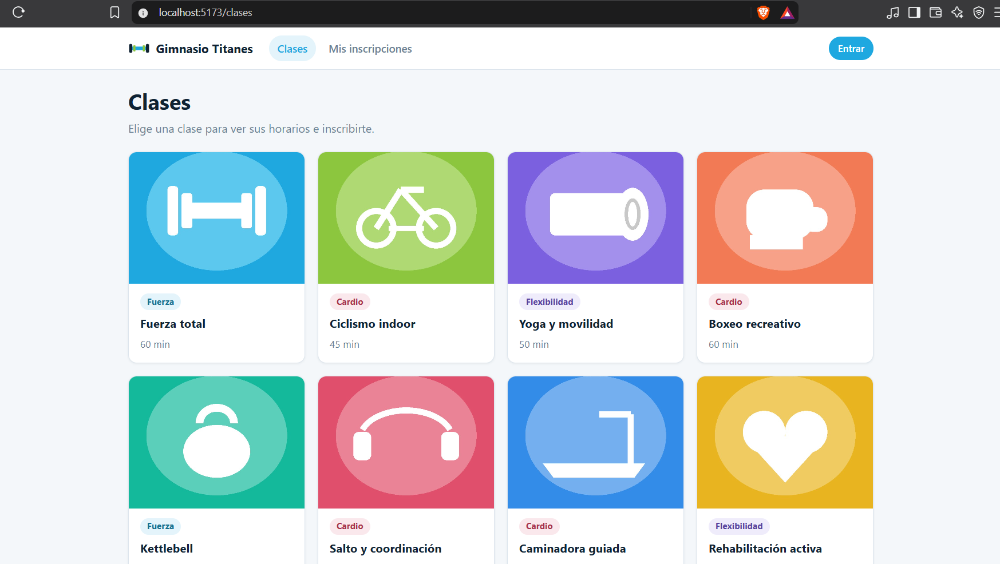
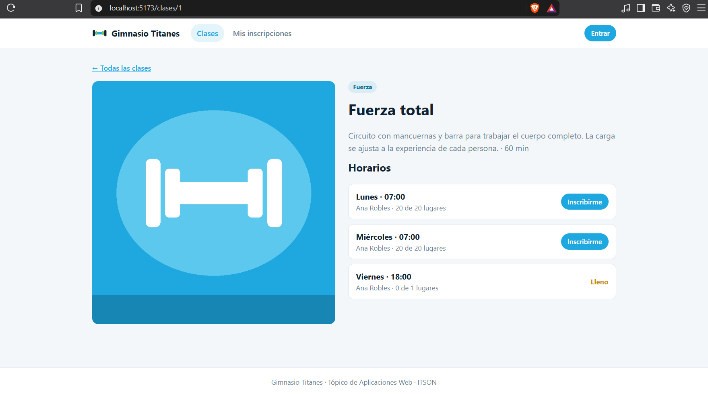
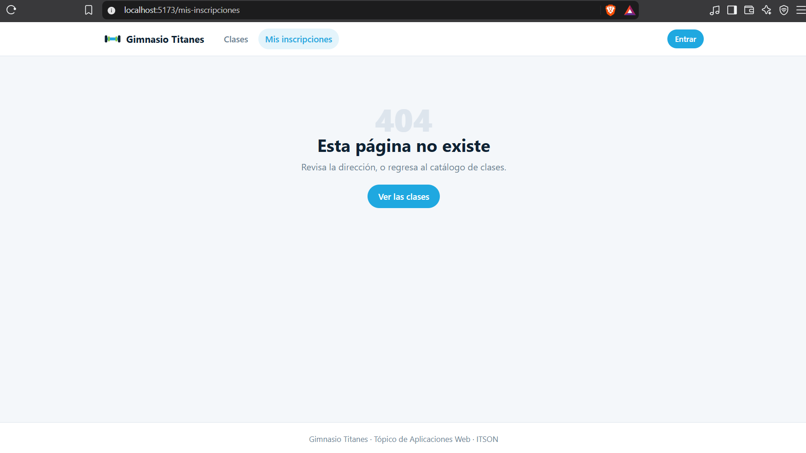
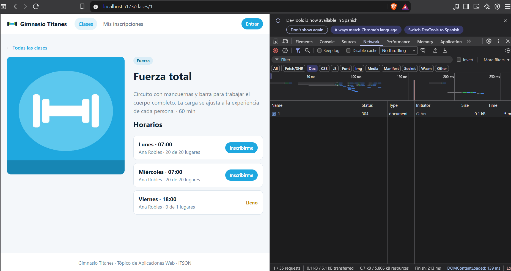
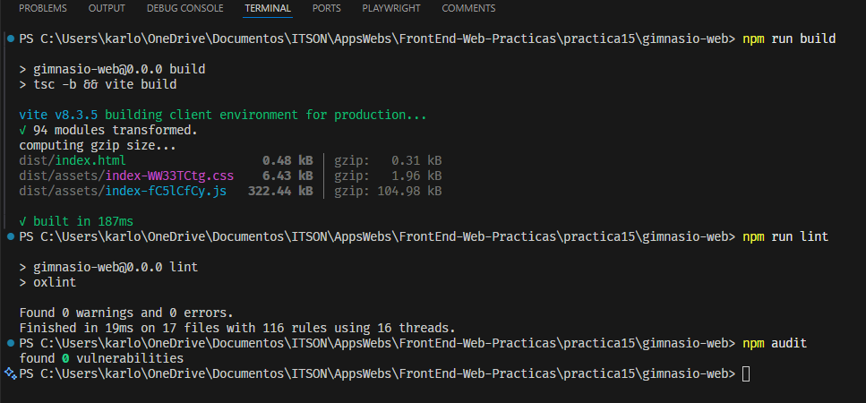

# Práctica 15 — El Gimnasio, Rutas y Layout

## Objetivo

En esta práctica se trabajó en la navegación de una aplicación de gimnasio con React Router. Se tomó como base el avance realizado durante la clase y se completaron las rutas del catálogo, el detalle de cada clase y la página para las direcciones que no existen.

El encabezado y el pie de página se comparten mediante un layout. La información de las clases y sus horarios se consulta desde la API proporcionada, que utiliza NestJS, Prisma y MySQL.

## Organización del proyecto

- `gimnasio-web/`: aplicación con React, TypeScript y Vite.
- `gimnasio-web/src/componentes/`: layout, encabezado, pie de página y componentes de carga y error.
- `gimnasio-web/src/paginas/`: catálogo, detalle de la clase y destino de la navegación a Entrar.
- `gimnasio-web/src/hooks/`: consulta del catálogo y de una lase por su identificador.
- `gimnasio-web/src/servicios/`: cliente Axios y funciones pacra consultar la API.
- `gimnasio-backend/`: backend proporcionado, imágenes, migración y datos iniciales.
- `evidencias/`: capturas de las pruebas de navegación.

## Rutas y funcionamiento

La ruta `/` redirige a `/clases`. El catálogo muestra la imagen, categoría y duración de cada clase. Cada tarjeta utiliza `Link` para abrir `/clases/:id` sin recargar toda la aplicación.

El detalle obtiene el identificador con `useParams` y consulta sus propios datos mediante `useClase`. Los horarios muestran el día, la hora, el entrenador y los lugares disponibles respecto al cupo máximo. Cuando ya no hay lugares, se muestra **Lleno** en lugar del botón de inscripción.

El botón **Inscribirme** utiliza `useNavigate` para dirigirse a `/entrar`. En esta entrega, esa ruta presenta la información de acceso; el inicio de sesión queda fuera del alcance de la práctica. La ruta `/mis-inscripciones` conserva el enlace del avance de clase y, al no estar implementada todavía, muestra la página 404.

Todas estas rutas están dentro del mismo `Layout`, por lo que conservan el encabezado y el pie de página.

## Preguntas de reflexión

### 1. ¿Por qué la página 404 conserva el encabezado y el pie de página?

Porque la ruta `*` está dentro de la ruta que utiliza `Layout`. Cuando la dirección no coincide con las otras rutas, React Router coloca el componente `NoEncontrado` en el `Outlet`.

El encabezado y el pie de página pertenecen al layout, por lo que siguen apareciendo. Lo que cambia es el contenido del centro de la página.

### 2. ¿Qué diferencia se observa en Network al utilizar Link y un enlace con href?

Con `Link`, React Router cambia la dirección y el contenido de la aplicación sin solicitar un nuevo documento HTML. Al abrir el detalle, se realiza la petición a la API para obtener la clase y sus horarios, además de los recursos que todavía no estén en caché.

Con un enlace normal `<a href>`, el navegador realiza una navegación completa. En Network aparece una nueva solicitud de tipo `document` y la aplicación vuelve a iniciarse. Algunos archivos pueden recuperarse de la caché, pero sigue existiendo la recarga del documento.

En desarrollo, `StrictMode` también puede provocar dos consultas iniciales. Eso no significa que `Link` haya recargado la página.

### 3. ¿De qué tipo es el identificador que devuelve useParams y qué pasa si no se convierte?

El parámetro llega como texto y también puede ser `undefined`, aunque represente un número en la dirección. Por eso se utiliza `Number(id)` y se comprueba que el resultado sea un entero positivo antes de consultar la API.

Sin esa conversión, no coincide con el parámetro numérico esperado por el servicio y una comparación estricta con un identificador numérico no daría el resultado esperado. Al formar una URL, el texto `"1"` podría producir la misma dirección que el número `1`, pero eso no sustituye la validación del identificador.

### 4. ¿Qué pasa al cambiar de /clases/1 a /clases/2 si el efecto no depende del identificador?

React puede reutilizar el componente del detalle porque ambas direcciones pertenecen a la misma ruta. Si el efecto no incluye `id` en sus dependencias, no se ejecuta nuevamente para consultar la segunda clase.

Esto deja los datos anteriores sin actualizar. En este proyecto, el hook también comprueba a qué identificador pertenece el resultado para evitar mostrar una clase distinta; sin la dependencia, se quedaría esperando la consulta de la nueva clase. Por eso el efecto depende de `id` y del contador utilizado para reintentar.

La limpieza del efecto evita que una respuesta anterior reemplace los datos de una consulta más reciente.

## Ejecución

Se requiere Node.js compatible con Vite y Prisma, y MySQL 8. La base de datos de esta entrega es `gimnasio_practica15`, independiente de las prácticas anteriores.

### Backend

Desde `gimnasio-backend/`:

```powershell
npm install
Copy-Item .env.ejemplo .env
```

En `.env` se configuran las credenciales locales de MySQL y un `JWT_SECRET` propio de al menos 32 caracteres. El archivo con los valores reales está excluido de Git.

La base de datos se puede crear desde MySQL Workbench:

```sql
CREATE DATABASE IF NOT EXISTS gimnasio_practica15
  CHARACTER SET utf8mb4 COLLATE utf8mb4_unicode_ci;
```

Después se aplica la migración y se generan los datos iniciales:

```powershell
npx prisma generate
npx prisma migrate deploy
npx prisma db seed
npm run build
npm run start:prod
```

El seed reemplaza los registros de la base configurada. Se utiliza con la base exclusiva de esta práctica para preparar ocho clases y sus horarios. **Fuerza total** incluye un horario con cupo completo para comprobar el estado **Lleno**.

La API queda disponible en `http://localhost:3000` y las imágenes se sirven desde `/img/`.

### Frontend

Desde otra terminal, en `gimnasio-web/`:

```powershell
npm install
Copy-Item .env.ejemplo .env
npm run dev
```

`VITE_API_URL` indica la dirección del backend. El valor de ejemplo es `http://localhost:3000`. El frontend se abre en `http://localhost:5173`.

## Verificación

Se comprobó la redirección al catálogo, la navegación al detalle, la consulta de los horarios, el estado de cupo lleno, la navegación a Entrar y la página 404 dentro del layout.

En el frontend se ejecutaron `npm run build` y `npm run lint` sin errores. En el backend se generó el cliente de Prisma, se aplicó la migración, se cargaron los datos iniciales y se compiló el proyecto.

La auditoría del frontend y la auditoría de dependencias de ejecución del backend (`npm audit --omit=dev`) no reportaron vulnerabilidades. La auditoría completa del backend conserva avisos en las herramientas de desarrollo del código base; no se aplicaron actualizaciones de versión mayor para eliminarlos.

## Evidencias

### 1. Catálogo de clases

Se muestran las ocho clases con su imagen y categoría.



### 2. Detalle y horario lleno

El detalle de Fuerza total muestra la descripción, los entrenadores y el cupo de cada horario. El viernes aparece lleno, con cero lugares disponibles.



### 3. Página 404 dentro del layout

La dirección `/mis-inscripciones`, que todavía no tiene una página implementada, muestra el componente 404 conservando el encabezado y el pie de página.



### 4. Navegación con Link

Al abrir el detalle desde el catálogo, Network muestra las consultas XHR con respuesta 200 sin una nueva petición de documento.


### 5. Comparación con un enlace normal

Para comparar ambos comportamientos, se probó la tarjeta con `<a href>`. Network muestra una petición de tipo `document` con estado 304, por la reutilización de la caché. La versión final utiliza `Link`.



### 6. Verificación final del frontend

La compilación terminó correctamente, la revisión del código reportó cero errores y advertencias, y la auditoría no encontró vulnerabilidades.



## Referencias

- Guía **Práctica 15 — El Gimnasio, Rutas y Layout**.
- Avance desarrollado en clase en `clases/P15/gimnasio-web`.
- Código base, estilos, imágenes y backend proporcionados para la práctica.
