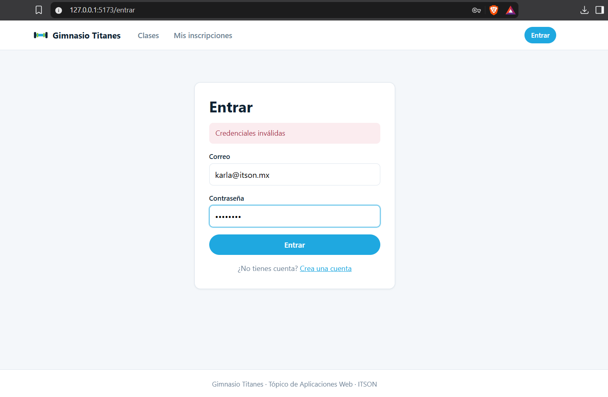
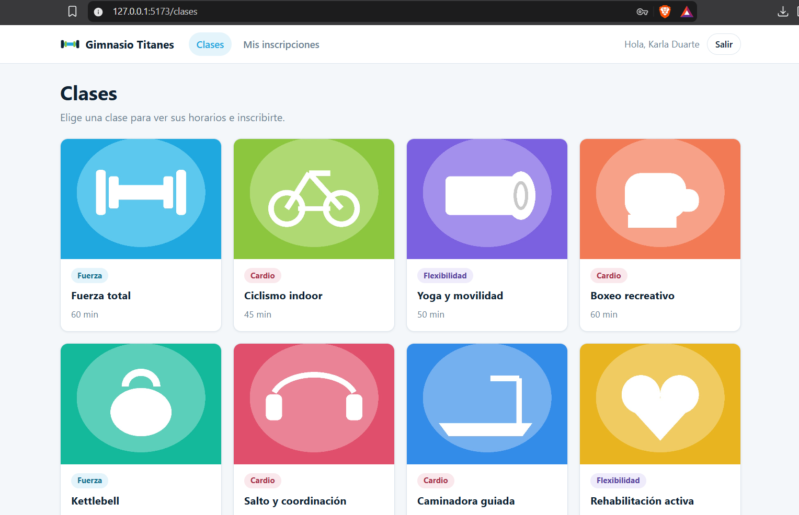
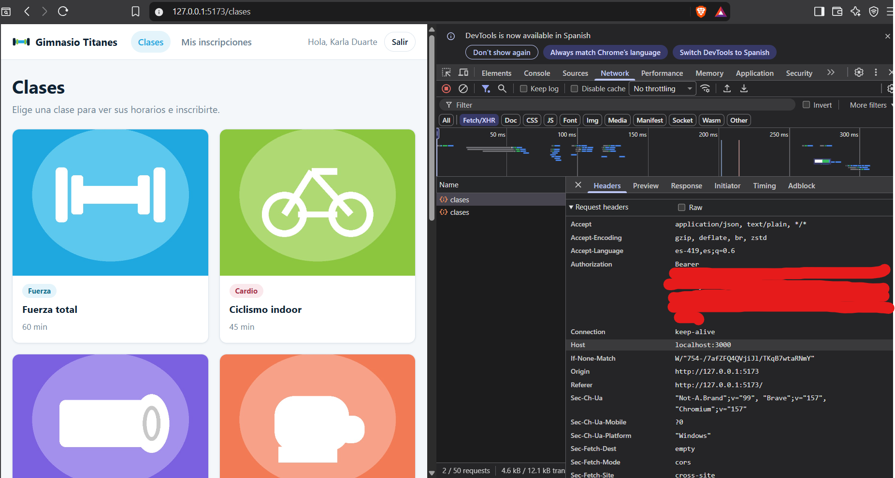
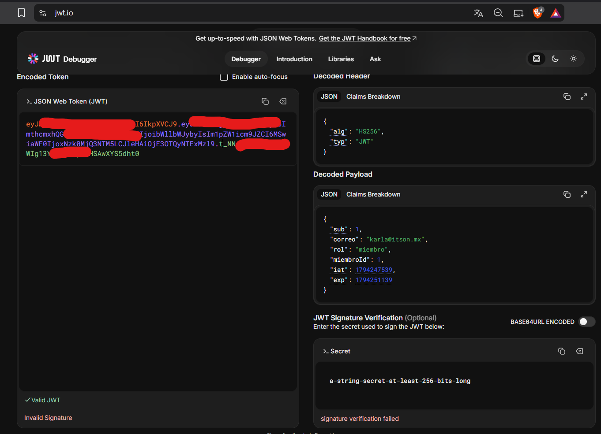
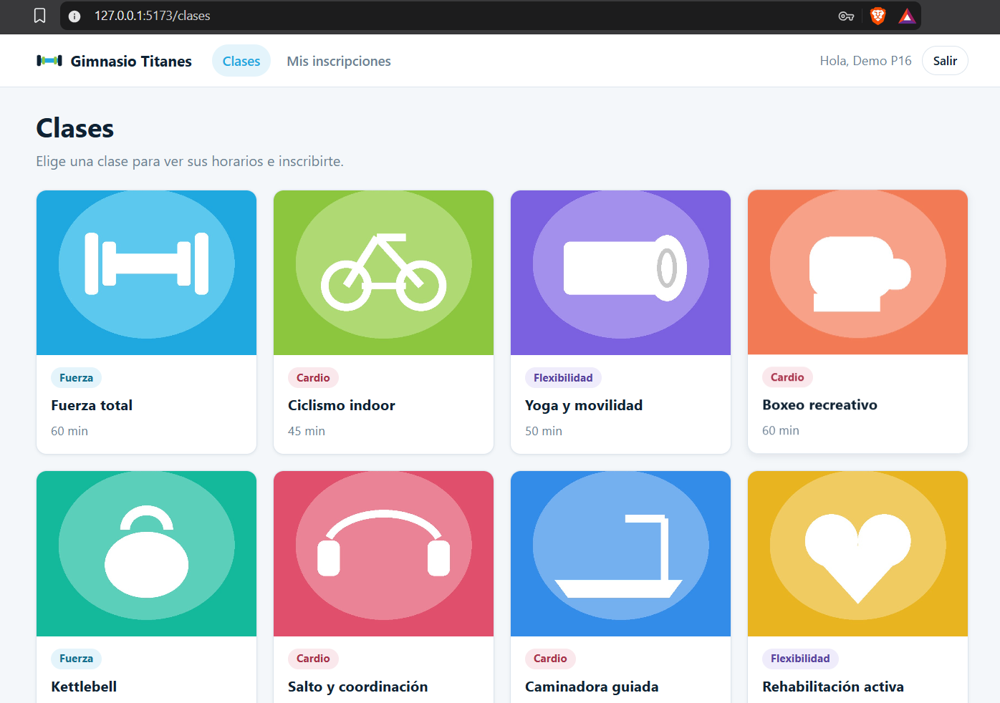

# Práctica 16 — El gimnasio con contexto de sesión y JWT

En esta práctica se agregó el inicio de sesión y el registro al frontend del gimnasio. Se retomaron el catálogo y las rutas de la práctica 15 junto con los formularios, el contexto y el flujo de autenticación de la clase 16. Se utiliza el mismo backend del gimnasio, que verifica las credenciales y emite el JWT.

## Flujo de sesión

1. En `/entrar`, React guarda el correo y la contraseña en el estado del formulario. Al enviarlo, se llama a `POST /auth/login`.
2. La API comprueba las credenciales. Si son correctas, devuelve `data.access_token` y `data.usuario`. Si son incorrectas, devuelve 401 y el formulario muestra **Credenciales inválidas**.
3. El proveedor guarda la sesión en `localStorage` con la clave `gimnasio.sesion` y actualiza su estado. El encabezado lee ese estado y muestra el nombre y el botón **Salir**.
4. Antes de cada petición de la instancia de Axios, el interceptor lee la sesión guardada y agrega el encabezado `Authorization: Bearer <token>` cuando hay un token.
5. Al recargar, el proveedor recupera la sesión guardada. Al salir, elimina esa entrada y actualiza el estado para que vuelva a aparecer **Entrar**.

El formulario de `/registro` llama a `POST /auth/registro`. La respuesta tiene la misma estructura que la del login, por lo que quien crea una cuenta queda con sesión iniciada y vuelve al catálogo.

## Preguntas de reflexión

### ¿Por qué se usa un contexto y no props para la sesión?

El encabezado y los formularios necesitan la misma sesión y están en distintas ramas de la aplicación. El contexto permite que cada uno lea el estado del proveedor con `useSesion`. Con props, habría que pasar esos datos y funciones por componentes intermedios como `App` y `Layout`, aunque no los usen.

El estado del proveedor conserva el valor mientras la aplicación está abierta. El contexto lo comparte con los componentes y `localStorage` permite recuperarlo después de una recarga.

### ¿Qué pasa si un componente usa la sesión fuera del proveedor?

`useContext` obtiene el valor predeterminado, que en este proyecto es `null`. El hook `useSesion` detecta esa situación y lanza un error que señala dónde debe colocarse el componente. Dentro del proveedor, una visita sin sesión recibe un objeto de contexto válido con `usuario: null`, así que el encabezado puede mostrar **Entrar**.

### ¿Dónde se guarda el token y qué riesgo tiene ese lugar?

El token y los datos del usuario se guardan juntos en `localStorage`. La información sigue ahí después de recargar, pero JavaScript del mismo origen puede leerla. Si se ejecuta un script malicioso por una vulnerabilidad XSS, puede copiar el token y usarlo mientras sea válido.

El JWT está firmado y su contenido se puede leer. El backend comprueba la firma y la caducidad antes de aceptar el token en una ruta protegida. La API del ejercicio emite tokens con una hora de vigencia. Salir borra la copia del navegador. Si alguien ya hubiera copiado el token, el backend aún podría aceptarlo hasta su vencimiento.

## Ejecución

La práctica usa el [backend del gimnasio](../practica15/README.md#backend) en `http://localhost:3000`. La base debe estar migrada y tener las cuentas del seeder. Si ya se cargaron los datos, basta con arrancar el backend.

Desde `gimnasio-web/`:

```powershell
npm ci
npm run dev -- --host 127.0.0.1 --port 5173 --strictPort
```

El frontend abre en `http://127.0.0.1:5173`. La variable `VITE_API_URL` permite indicar otra dirección para la API. El archivo `.env.ejemplo` contiene un ejemplo.

## Verificación

El frontend compila con `npm run build` y pasa la revisión de código con `npm run lint`. En el navegador se comprobó el mensaje de credenciales inválidas, el saludo tras iniciar sesión, la recuperación de la sesión al recargar y el regreso a **Entrar** al cerrar sesión.

## Evidencias

### 1. Credenciales inválidas

El formulario muestra el mensaje devuelto por la API cuando las credenciales son incorrectas.



### 2. Sesión iniciada

El encabezado muestra el nombre de la usuaria y el botón **Salir** al volver al catálogo.



### 3. Encabezado Authorization

Después de recargar el catálogo con la sesión iniciada, la petición a `/clases` incluye el encabezado `Authorization: Bearer`. La captura oculta el valor del JWT.



### 4. JWT decodificado

Se usó una copia con la firma alterada para leer el encabezado y el contenido en jwt.io. El encabezado indica el algoritmo HS256 y el contenido muestra el identificador del usuario, su rol y los tiempos de emisión y vencimiento. La diferencia entre `iat` y `exp` es de 3600 segundos. El aviso de firma inválida corresponde a la copia alterada.



### 5. Registro exitoso

Después de registrar la cuenta de prueba, la aplicación vuelve al catálogo con la sesión iniciada. El encabezado muestra el nombre de la cuenta nueva y el botón **Salir**.


