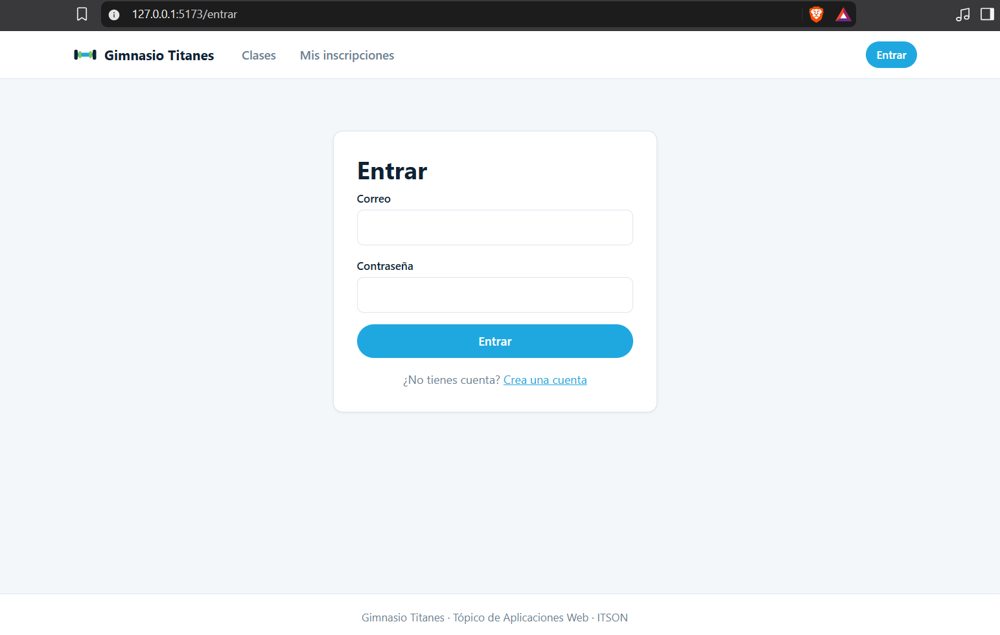
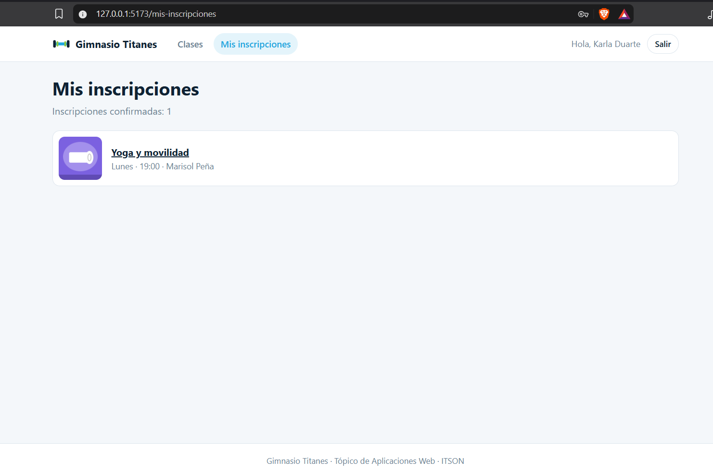
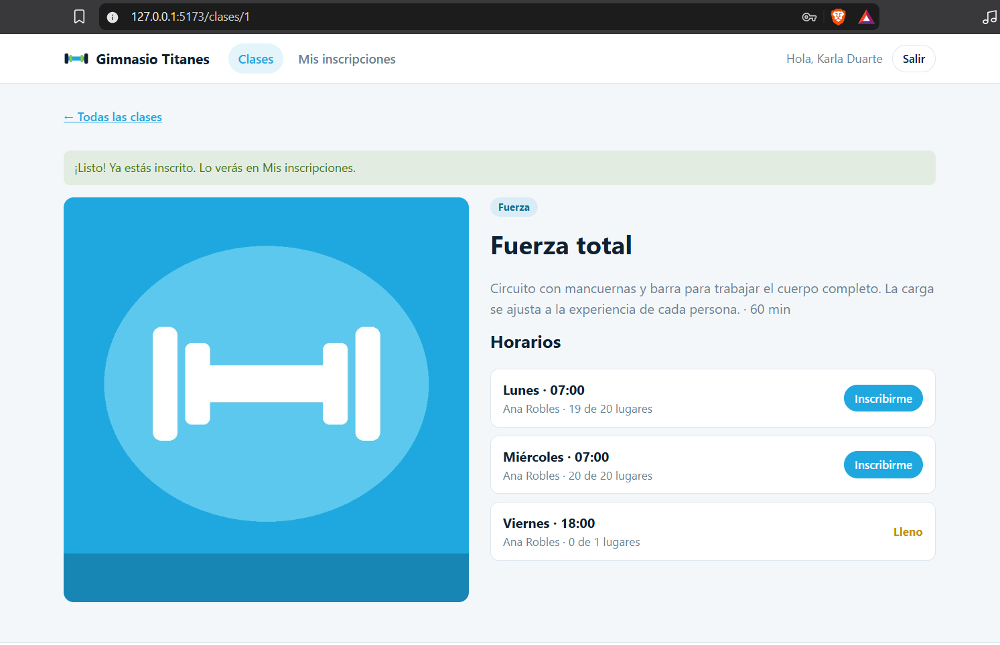
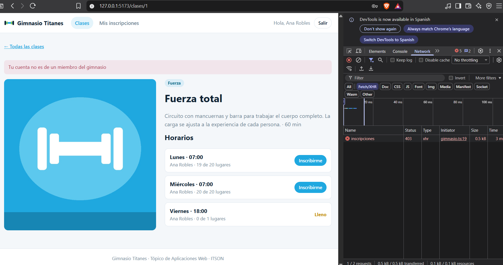
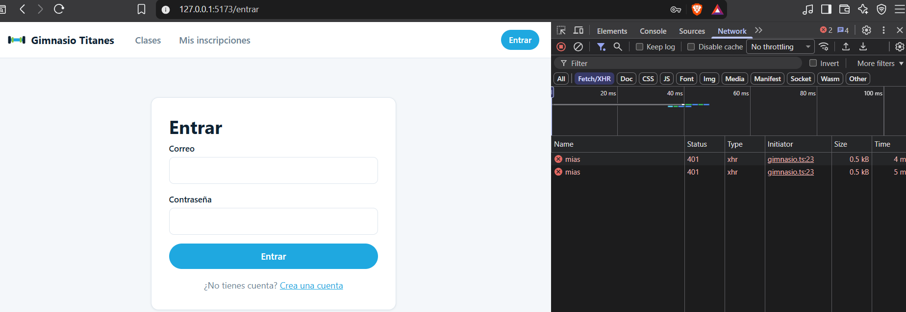
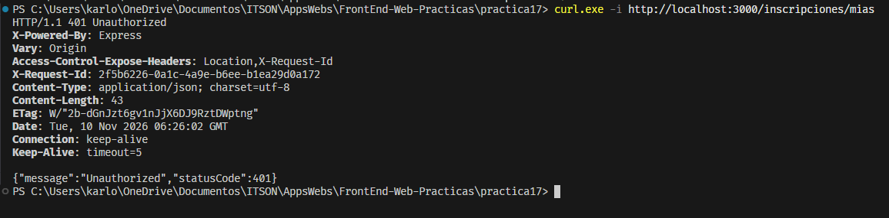

# Práctica 17 — Rutas protegidas e inscripciones

En esta práctica se agregó la página **Mis inscripciones** al frontend del gimnasio. Se retomaron el catálogo y la sesión de las prácticas anteriores, junto con la ruta protegida y la lista de inscripciones del código de la clase 17.

## Flujo de la aplicación

- Si se abre `/mis-inscripciones` sin sesión, `RutaProtegida` lleva a `/entrar` y guarda la ruta solicitada en el estado de navegación. Al iniciar sesión, el formulario usa ese dato para regresar a la página original.
- Si se pulsa **Inscribirme** sin sesión, se guarda como destino el detalle de la clase. Después de entrar, se puede elegir el horario de nuevo.
- Con sesión, el frontend manda `POST /inscripciones` con `{ horarioId }`. Cuando la API confirma, se muestra un aviso y se vuelven a consultar los horarios para actualizar el cupo.
- Si la API responde con 403 o 409, la página muestra su mensaje. Un 401 fuera del login o del registro borra la sesión si rechaza el token actual o si ya no se puede leer la sesión guardada. El proveedor recibe un aviso y, si se está viendo **Mis inscripciones**, la ruta protegida lleva de nuevo a **Entrar**.

## Preguntas de reflexión

### ¿La ruta protegida hace segura la aplicación?

La ruta de React controla qué pantalla se muestra y evita pedir inscripciones cuando no hay sesión. Alguien puede modificar el código que corre en su navegador o llamar directamente a la API. La protección de `GET /inscripciones/mias` ocurre en el backend, que exige un JWT válido y obtiene del token el miembro cuyas inscripciones puede devolver.

La comprobación directa se realiza sin el encabezado Authorization:

```powershell
curl.exe -i http://localhost:3000/inscripciones/mias
```

La respuesta esperada es `401 Unauthorized`.

### ¿Por qué el frontend no manda miembroId al inscribirse?

El horario es lo que selecciona la persona en la interfaz. Su identidad ya está en el JWT que el servidor firmó. El backend obtiene el `miembroId` del token cuando el formulario manda solo el horario. Si un miembro intenta enviar el identificador de otra persona, el backend lo rechaza con 403. La API admite un identificador explícito para operaciones del personal, que tienen permisos distintos.

### ¿Qué diferencia hay entre un 401 y un 403?

Un 401 indica que la API no pudo autenticar la petición. Por ejemplo, el token falta, venció o tiene una firma inválida. Si el token rechazado es el de la sesión actual, el frontend borra la sesión. El 401 del formulario de login se muestra como credenciales inválidas.

Un 403 indica que la API pudo identificar a la persona, pero su cuenta carece de permiso para la operación. Por ejemplo, una cuenta de entrenadora que intenta inscribirse a sí misma sigue autenticada, pero recibe un 403 porque no está asociada a un miembro. Un 409 corresponde a una inscripción que entra en conflicto con una regla, como intentar inscribirse dos veces al mismo horario.

## Ejecución

Se usa el [backend del gimnasio](../practica15/README.md#backend) en `http://localhost:3000`, con la base migrada y los datos de prueba cargados.

Desde `gimnasio-web/`:

```powershell
npm ci
npm run dev -- --host 127.0.0.1 --port 5173 --strictPort
```

El frontend abre en `http://127.0.0.1:5173`. Si la API usa otra dirección, se puede definir `VITE_API_URL` como se muestra en `.env.ejemplo`.

## Verificación

La aplicación compiló con `npm run build` y pasó la revisión con `npm run lint`. La llamada directa a `GET /inscripciones/mias` sin token devolvió 401. En el navegador se comprobó el regreso a **Mis inscripciones** después del login y el regreso al detalle cuando se intenta inscribir sin sesión. También se comprobaron el aviso por un horario duplicado y el rechazo de una inscripción desde una cuenta de entrenadora.

## Evidencias

### 1. Redirección a Entrar

Al abrir **Mis inscripciones** sin sesión, el navegador redirige a `/entrar`.



### 2. Regreso a Mis inscripciones

Tras iniciar sesión, la aplicación vuelve a la ruta solicitada y muestra la inscripción de Karla en Yoga y movilidad.



### 3. Inscripción exitosa y actualización del cupo

La API confirma la inscripción de Karla en Fuerza total, el lunes a las 07:00. Al consultar de nuevo los horarios, el cupo disponible baja de 20 a 19.



### 4. Inscripción duplicada

Al repetir la inscripción en el mismo horario, la API responde con 409 y la página muestra «Ya estás inscrito en este horario». El cupo se mantiene en 19 lugares disponibles.


### 5. Inscripción con una cuenta de entrenadora

La API devuelve 403 cuando Ana intenta inscribirse con su cuenta de entrenadora. La página muestra el mensaje de la API y el encabezado mantiene la sesión de Ana.



### 6. Cierre de sesión con un token falso

Al abrir **Mis inscripciones** con un token falso, la API devuelve 401. El interceptor borra la sesión y la ruta protegida redirige a `/entrar`.



### 7. Consulta directa sin token

La llamada con curl a `GET /inscripciones/mias` devuelve `401 Unauthorized` cuando no se incluye el encabezado Authorization. La API protege los datos incluso cuando se consulta desde la terminal.


