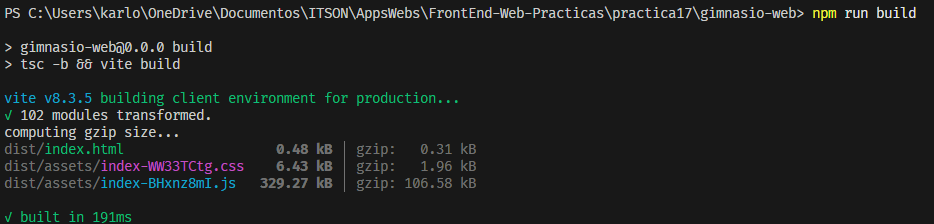
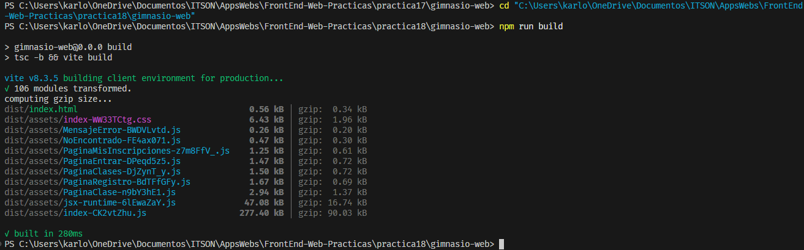
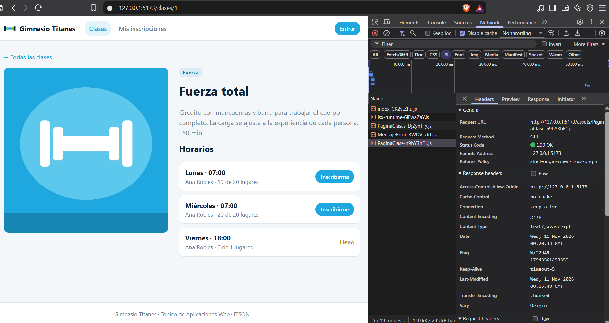
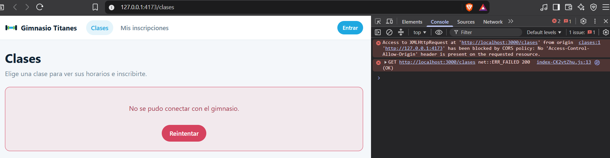
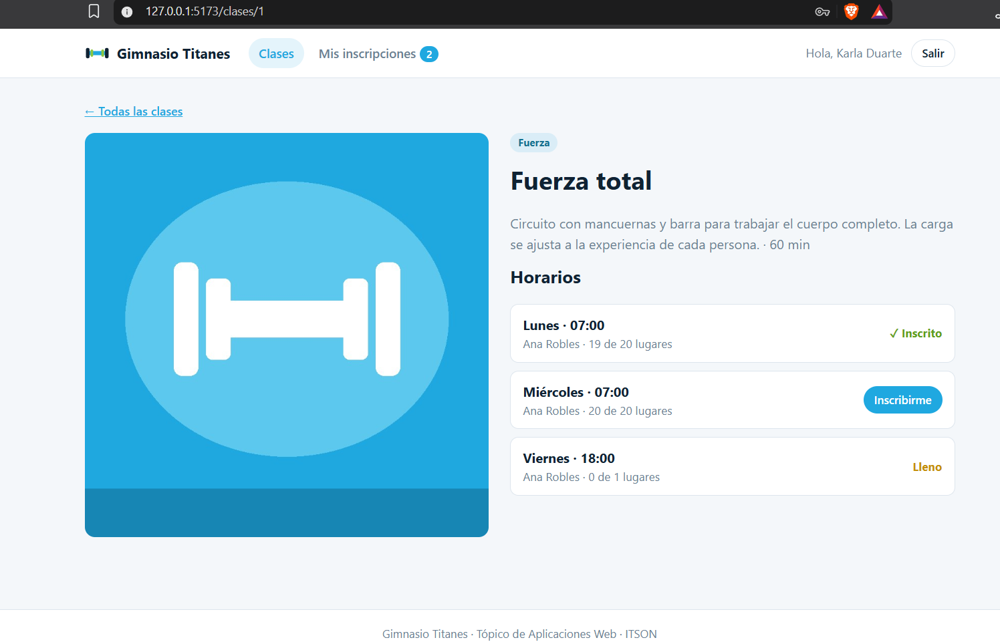
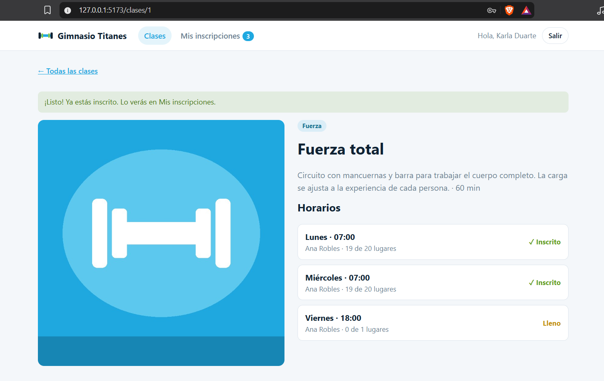

# Práctica 18 — Lazy loading, build y Zustand

Se retomaron las rutas, el catálogo y la sesión de la práctica 17. Se separó el código por pantalla y se concentraron las inscripciones en un store que comparten el encabezado, el detalle de la clase y **Mis inscripciones**.

## División del código

Las pantallas se cargan con `lazy(() => import(...))`. El `import()` dinámico le indica a Vite dónde puede separar el código. Al renderizar una ruta por primera vez, React solicita el módulo correspondiente, que exporta su pantalla por defecto.

El `Suspense` del layout envuelve al `Outlet`. Mientras llega el código de una pantalla, aparece **Cargando…** en el contenido central. El encabezado y el pie siguen visibles. La carga de las peticiones a la API tiene su propio estado.

En el catálogo, `loading="lazy"` permite que el navegador aplace imágenes alejadas de la zona visible. Puede solicitar alguna antes de que aparezca en pantalla, según la distancia al área visible y las condiciones de red.

## Comparación del build

- **Antes**, la versión de la práctica 17 generó un solo JavaScript de **329.27 kB** (**106.58 kB gzip**) y un CSS de **6.43 kB**.
- **Después de separar las rutas**, sin incorporar todavía el código del store, el archivo principal midió **322.87 kB**. Al sumar el catálogo y su dependencia compartida, la entrada a **Clases** quedó en unos **324.87 kB**.
- **Build final con Zustand**, el archivo principal mide **277.40 kB** y se carga junto con `jsx-runtime` (**47.08 kB**). La primera visita al catálogo también necesita `PaginaClases` (**1.50 kB**) y `MensajeError` (**0.26 kB**). La suma es de aproximadamente **326.3 kB** antes de comprimir. Las demás pantallas tienen sus propios archivos.

Las cifras gzip son estimaciones de Vite para cada archivo. El tamaño transferido que muestra Network también depende del servidor y de la caché.

## Store de inscripciones

Al iniciar o recuperar una sesión de miembro, el proveedor solicita las inscripciones confirmadas y las guarda con Zustand. El encabezado lee la cantidad con un selector. La página **Mis inscripciones** lee la lista del mismo store y abrirla no dispara otra consulta. Si la carga falló, el botón de reintento vuelve a consultar la API.

Después de una inscripción confirmada, el detalle vuelve a pedir el cupo y actualiza el store. El contador cambia y el horario aparece marcado como **Inscrito**. Cerrar sesión o recibir un 401 que la invalida vacía la lista. El store descarta respuestas de consultas anteriores que todavía estén en camino.

## Preguntas de reflexión

### ¿Cuánto se ahorró y por qué el ahorro es pequeño?

La separación por rutas aplazó unos **4.40 kB** en la primera visita al catálogo antes de integrar el store. En la versión final la diferencia frente a la práctica 17 es de unos **3 kB**, aproximadamente **0.9 %** sin comprimir. Mirar solo `index` exageraría el ahorro, porque el navegador también carga dependencias compartidas y el módulo de la ruta inicial.

La mayor parte del código corresponde a dependencias y funciones compartidas que el catálogo necesita. Las pantallas individuales son pequeñas. La división aplaza su descarga hasta la primera visita y agrega algo de código para cargar módulos, por lo que el conjunto completo de archivos puede pesar más. En esta medición la suma gzip del JavaScript inicial incluso subió de **106.58 kB** a unos **107.69 kB**.

### ¿Por qué falla la API si preview corre en el puerto 4173?

El origen incluye protocolo, host y puerto. `http://127.0.0.1:4173` y `http://127.0.0.1:5173` son orígenes distintos. El backend permite el origen del puerto 5173. Cuando el navegador hace una petición desde 4173, la API no devuelve un encabezado CORS que autorice ese origen y el navegador impide que el frontend lea la respuesta. Un GET público puede recibir HTTP 200 del servidor y aun así quedar bloqueado por el navegador.

### ¿Cuándo conviene un contexto y cuándo un store?

El contexto es práctico para compartir un valor ligado a un árbol de componentes, como la sesión y sus funciones de entrada y salida. El store sirve cuando varias pantallas necesitan leer y actualizar los mismos datos. Aquí el encabezado solo se suscribe a la longitud de la lista, mientras que el detalle y **Mis inscripciones** consultan la lista completa. Zustand permite que cada consumidor se suscriba al fragmento que necesita.

## Ejecución

Se usa el [backend del gimnasio](../practica15/README.md#backend) en `http://localhost:3000`, con los datos de prueba cargados. Desde `gimnasio-web/` se compila y se sirve el resultado:

```powershell
npm ci
npm run build
npm run preview -- --host 127.0.0.1 --port 5173 --strictPort
```

El preview se abre en `http://127.0.0.1:5173`. El puerto 4173 se usa para reproducir el rechazo de CORS de la guía, manteniendo la configuración de la API.

## Verificación

Pasaron la compilación y la revisión con `npm run lint`. En el preview de 5173 se comprobó que las inscripciones de Karla coinciden con el contador del encabezado, que un horario existente aparece como **Inscrito** y que el contador desaparece al cerrar sesión. En el preview de 4173 el navegador mostró el error al intentar cargar el catálogo.

## Evidencias

### 1. Build antes de separar las rutas

La práctica 17 sirve como referencia. Vite genera un solo JavaScript de 329.27 kB con las pantallas importadas desde el inicio.



### 2. Build con carga por ruta y Zustand

La práctica 18 genera archivos separados para las pantallas y módulos compartidos. La salida de Vite muestra el tamaño de cada archivo y su estimación con gzip.



### 3. Carga diferida del detalle

En el preview de 5173, el catálogo carga su módulo al abrirse. Al seleccionar **Fuerza total**, Network registra una petición posterior para el módulo `PaginaClase`, que responde con 200.



### 4. Bloqueo de CORS en el puerto 4173

La API devuelve HTTP 200 para `GET /clases`. Como la respuesta carece de `Access-Control-Allow-Origin` para el origen del preview en 4173, el navegador impide que la aplicación lea los datos.



### 5. Contador antes de inscribirse

Karla tiene dos inscripciones confirmadas. El horario de Fuerza total del miércoles a las 07:00 muestra 20 lugares disponibles y el botón **Inscribirme**.



### 6. Contador después de inscribirse

Al confirmar la inscripción, la aplicación actualiza la lista en Zustand y vuelve a consultar el cupo. El contador sube a tres, el horario muestra **Inscrito** y quedan 19 lugares disponibles.


